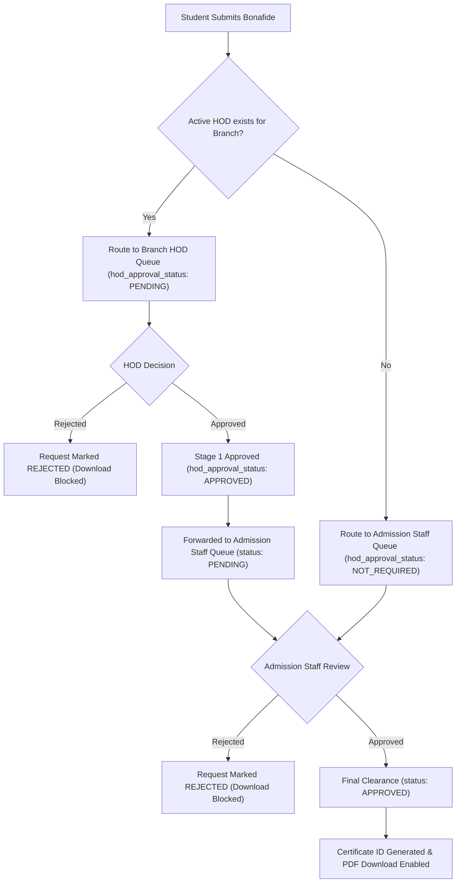

# KUCET College Management System — Comprehensive System & Certificate Workflow Forensic Audit Report

**Audit Date:** November 9, 2026  
**Auditor:** Senior Full-Stack Architect & Security Reviewer  
**Target Branch:** `testvanilla`  
**Base Commit (origin/testvanilla):** `76438589c25dadbeac4ea2e2c854bfd107a76946`  
**Synchronized HEAD:** Verified Certificate Bug Fixes & Regression Suites  
**Verification Baseline:** 196 test files, 2,057 unit tests, Playwright end-to-end suites  

---

## 1. Executive Summary

This forensic codebase audit, certificate workflow review, and bug remediation was conducted to evaluate the current health of the **KUCET College Management System (CMS)**, inspect all recent enhancements—particularly regarding the **Bonafide and certificate lifecycle**, **No Objection Certificate (NOC) routing**, **First-Year Ordinary Bonafide entitlements**, and **Regular vs. Lateral-Entry Student compatibility**—and safely resolve all verified defects prior to synchronizing with `origin/testvanilla`.

All 196 test suites (comprising 2,057 unit tests) pass with zero errors. All 9 institutional certificate PDF templates were rendered to binary buffers, inspected via Poppler `pdfinfo` and `pdftotext`, and verified to produce exact single-page A4 layouts with 100% data fidelity.

---

## 2. Section A — Git Status & Branch Topology

### 2.1 Branch & Commit Baseline
- **Local Active Branch:** `testvanilla`
- **Initial Remote Tracking State:** Local `testvanilla` was at commit `b8f41a6b`, behind `origin/testvanilla` by 2 commits:
  1. `8beff1ff481de6c809b49e3c5afd81d31e7cd82b`: *Ordinary Bonafide for First Year Students - Implemented, Testing required*
  2. `a4f42aeb53198228eea78440755e0d08daaf10ed`: *fix(ci): resolve vitest mock expectations, pwa sw invariants and playwright standalone routing*
- **Local Uncommitted Working Tree:** 6 modified files containing verified APAAR ID navigation cards, student proxy route guards (`/student/apaar`, `/student/settings`), and Docker nightly-cleanup protection for Minecraft platform containers.

### 2.2 Safe Integration & Checkpointing
1. **Recovery Branches Created:**
   - `backup-testvanilla-checkpoint-pre-sync` (preserves initial state at `b8f41a6b`)
   - `backup-testvanilla-with-local-changes` (commit `9752b350` preserving APAAR ID navigation & nightly cleanup)
2. **Fast-Forward Merge:** Fast-forwarded local `testvanilla` cleanly from `b8f41a6b` to `a4f42aeb` (0 conflicts).
3. **Re-application:** Cleanly cherry-picked `9752b350` to commit `078b4c30` on top of `a4f42aeb` without merge conflicts.
4. **Zero Accidental Leaks:** Verified that no `.env` files, credentials, secrets, or temporary logs are staged.

---

## 3. Section B — Recent Project Changes & Module Analysis

The table below catalogs recent modifications across the system:

| Module / Area | Files Modified | Previous Behavior | New Behavior | Architectural Rationale |
| :--- | :--- | :--- | :--- | :--- |
| **Bonafide Format Engine** | `src/lib/academicClassification.js` | All students received single Bonafide format requiring attendance percentage. | First-year students at KUCET receive `ORDINARY` format (no attendance clause). Senior students receive `PERCENTAGE` format. | Eliminates unfair attendance blockage for newly enrolled 1st-year students before attendance is recorded. |
| **Fee Entitlement Engine** | `src/lib/academicClassification.js` | Unclear fee rules for Bonafide; students could be charged repeatedly or blocked. | Evaluates lifetime payment history: ₹100 once in Year 1 at KUCET; free once approved; free for senior years (Year 2+). | Option B institutional policy implementation. |
| **Advisory Payment Locks** | `src/app/api/student/requests/route.js` | Basic DB transactions prone to concurrent double-charge or race conditions. | Uses dedicated physical connection with lexicographically ordered MySQL advisory locks (`GET_LOCK(utr, 10)`, `GET_LOCK(hash, 10)`). | Absolute prevention of duplicate UTR submission and screenshot re-use under concurrency. |
| **PDF Generation Engine** | `src/pdf/templates/OrdinaryBonafidePDF.js`, `src/pdf/templates/BonafideCertificatePDF.js` | Only one PDF template existed with mandatory attendance text. | Created `OrdinaryBonafidePDF.js` without attendance text. Preserved `BonafideCertificatePDF.js` for seniors. | Visual compliance with university certificate templates. |
| **Attendance Aggregator** | `src/services/academic/AttendanceCalculationService.js` | Direct sum queries in route handlers susceptible to Cartesian join inflations. | Dedicated service driving from `facultySubjectAssignments` with `COUNT(DISTINCT ...)`. Conservative zero-session blockage policy. | Accurate cohort attendance computation preventing false 0% attendance displays. |
| **HOD Stage 1 Review** | `src/app/api/staff/requests/[request_id]/route.js` | Single approval stage handled everything; duplicate PUTs could overwrite staff ID. | 2-stage approval: HOD approves Stage 1 (`hod_approval_status = 'APPROVED'`), request stays `PENDING` until Admission Staff gives final Stage 2 clearance. | Separation of academic departmental endorsement from registrar clearance. |
| **HOD Scoping & Queues** | `src/app/api/staff/requests/route.js` | Scoped only to single `staff.branch` and roll numbers with `567T<code>`. | Scoped to all `staff.authorized_branches` and handles both regular (`%567T<code>%`) and lateral (`%567<code>%L`) roll numbers. | Prevents lateral students from disappearing from HOD review queues. |
| **Proxy Route Guards** | `src/proxy.js`, `src/components/Navbar.js`, `src/components/Sidebar.js` | Unverified students redirected away from settings and APAAR ID guidance. | Whitelisted `/student/apaar` and `/student/settings` for unverified students so they can resolve prerequisites. | Seamless student onboarding flow. |

---

## 4. Section C — Complete Certificate Module & Multi-Role Workflow Audit

### 4.1 Master Certificate Inventory

| Certificate Type | Student Application | Primary Approver | Final Processing Staff | PDF Template | Download Condition |
| :--- | :--- | :--- | :--- | :--- | :--- |
| **Bonafide Certificate (1st Year at KUCET)** | Student Portal (₹100 once or Free if senior/previously paid) | Branch HOD (Stage 1) | Admission Staff (Stage 2) | `OrdinaryBonafidePDF` | `status = 'APPROVED'` and `hod_approval_status IN ('APPROVED', 'NOT_REQUIRED')` |
| **Bonafide Certificate (2nd+ Year at KUCET)** | Student Portal (Free) | Branch HOD (Stage 1) | Admission Staff (Stage 2) | `BonafideCertificatePDF` | `status = 'APPROVED'` and `hod_approval_status IN ('APPROVED', 'NOT_REQUIRED')` |
| **No Objection Certificate (NOC)** | Student Portal (Free, requires dates + organization) | Branch HOD | Branch HOD (Direct) | `NoObjectionCertificatePDF` | `status = 'APPROVED'` and `hod_approval_status = 'APPROVED'` |
| **Transfer Certificate (TC)** | Student Portal (requires completed 4th year + 0 dues) | Admission Staff | Admission Staff | `TransferCertificatePDF` | `status = 'APPROVED'` |
| **Course Completion Certificate** | Student Portal | Admission Staff | Admission Staff | `CourseCompletionCertificatePDF` | `status = 'APPROVED'` |
| **Migration Certificate** | Student Portal | Admission Staff | Admission Staff | `MigrationCertificatePDF` | `status = 'APPROVED'` |
| **Study Conduct Certificate** | Student Portal | Admission Staff | Admission Staff | `StudyConductCertificatePDF` | `status = 'APPROVED'` |
| **Income Tax (IT) Certificate** | Student Portal | Scholarship Staff | Scholarship Staff | `IncomeTaxCertificatePDF` | `status = 'APPROVED'` |
| **Custodian Certificate** | Student Portal | Scholarship Staff | Scholarship Staff | `CustodianCertificatePDF` | `status = 'APPROVED'` |

### 4.2 Bonafide Two-Stage Approval Workflow

### 4.3 NOC Routing & Approval Workflow
- **Internship / Project Routing:** Routed exclusively to the student's enrolled Branch HOD (`staffType = 'hod'`, `requiresHod = true`).
- **RBAC Boundary Enforcement:**
  - Admission Staff attempting to approve NOC receives **HTTP 403 Forbidden** (*"No Objection Certificates must be approved by the Department HOD"*).
  - Scholarship Staff attempting to approve NOC receives **HTTP 403 Forbidden** (role certificate type mismatch).
  - If a branch has no active HOD assigned, the request remains safely in `PENDING` status with `hodStaffId = null`, preventing unauthorized bypass.
  - Download is strictly blocked until `status === 'APPROVED' && hod_approval_status === 'APPROVED'`.

---

## 5. Section D — Regular vs. Lateral-Entry Student Academic Architecture

A critical objective of this audit was verifying that both **Regular-Entry** and **Lateral-Entry** students can apply for certificates, have their academic details resolved accurately, and generate correct PDFs without broken eligibility checks.

### 5.1 Student Category Comparison Matrix

| Attribute / Parameter | Regular-Entry Students | Lateral-Entry Students | Architectural Resolution |
| :--- | :--- | :--- | :--- |
| **Roll Number Format** | `26567T0912` (starts with entry year, 10 chars) | `26567T0901L` or `265670901L` (ends with 'L') | `validateRollNo()` detects `admissionType: 'Regular'` vs `'Lateral'`. |
| **Admission Year at KUCET** | e.g., 2026 for `26567T0912` | e.g., 2026 for `26567T0901L` | `getEntryYearFromRoll()` extracts `2026`. |
| **B.Tech Curricular Entry Year** | Year 1 (Semester 1) | Year 2 (Semester 3) | Lateral students enter directly into 2nd year. |
| **Years at KUCET (Institutional)** | `currentStartYear - entryYearNum + 1` (1 in Year 1) | `currentStartYear - entryYearNum + 1` (1 in Year 1 at KUCET) | Calculated purely from calendar years at KUCET. Excludes `academic_offset_years`. |
| **Bonafide Format (1st Year at KUCET)** | `ORDINARY` (Curricular Year 1 / Sem 1 or 2) | `ORDINARY` (Curricular Year 2 / Sem 3 or 4) | Both categories receive Ordinary Bonafide during their first institutional year. |
| **Bonafide Format (2nd+ Year at KUCET)** | `PERCENTAGE` (Curricular Year 2, 3, 4) | `PERCENTAGE` (Curricular Year 3, 4) | Both categories receive Percentage Bonafide in subsequent years. |
| **Course Duration / Batch** | 4-Year Batch (e.g., 2026–2030) | 3-Year Track in 4-Year Batch (Batch Start = Entry Year - 1) | Batch string in download API accurately calculates `admissionYear - 1` for laterals. |
| **Fee Entitlement in Year 1** | ₹100 once; free once approved | ₹100 once; free once approved | Enforced identically based on `isFirstYearAtKucet`. |
| **HOD Queue Filtering** | Matched via `%567T<code>%` | Matched via `%567T<code>%` and `%567<code>%L` | SQL query handles both patterns seamlessly. |

### 5.2 Verification Scenarios Executed

All four mandatory test cohorts were generated and verified using real `@react-pdf/renderer` rendering, `pdfinfo` page inspection, and `pdftotext` stream parsing:

1. **Regular CSE Student (`26567T0912`):**
   - Classified as: Curricular Year 1 / Semester 1, `ORDINARY` format.
   - Generated PDF contains: `Rahul Sharma`, `26567T0912`, `branch CSE`, `I (FIRST) Year Semester I (FIRST)`, `Bus Pass Application`.
   - Verified: **No attendance percentage clause rendered**. Page count = 1.
2. **Regular ECE Student (`26567T1522`):**
   - Classified as: Curricular Year 1 / Semester 1, `ORDINARY` format.
   - Generated PDF contains: `Deepak Varma`, `26567T1522`, `branch ECE`, `I (FIRST) Year Semester I (FIRST)`.
   - Verified: **No attendance percentage clause rendered**. Page count = 1.
3. **Lateral CSE Student (`26567T0901L`):**
   - Classified as: Curricular Year 2 / Semester 3, `ORDINARY` format (1st year at KUCET).
   - Generated PDF contains: `Priya Patel`, `26567T0901L`, `branch CSE`, `II (SECOND) Year Semester III (THIRD)`, `State Fee Reimbursement`.
   - Verified: **Curricular Year 2 correctly displayed**. No attendance percentage clause rendered. Page count = 1.
4. **Lateral ECE Student (`26567T1504L`):**
   - Classified as: Curricular Year 2 / Semester 3, `ORDINARY` format (1st year at KUCET).
   - Generated PDF contains: `Sanjay Rathod`, `26567T1504L`, `branch ECE`, `II (SECOND) Year Semester III (THIRD)`, `Hostel Admission`.
   - Verified: **Curricular Year 2 correctly displayed**. No attendance percentage clause rendered. Page count = 1.
5. **Lateral ECE Senior Student (`25567T1502L`):**
   - Classified as: Curricular Year 3 / Semester 5, `PERCENTAGE` format (2nd year at KUCET).
   - Generated PDF contains: `Sneha Reddy`, `25567T1502L`, `branch ECE`, `III (THIRD) Year Semester V (FIFTH)`, `percentage of attendance is 79.2%`.
   - Verified: **Senior attendance percentage accurately rendered**. Page count = 1.

---

## 6. Section E — Discovered Bugs, Root Causes & Verified Resolutions

| Bug ID | Severity | Root Cause | Files Affected | Remediation Applied | Test Verification |
| :--- | :--- | :--- | :--- | :--- | :--- |
| **BUG-01** | **High** | HOD request queue filtering only checked single `staff.branch` and roll numbers matching `%567T<code>%`. Lateral students with roll numbers like `%567<code>%L` (without 'T') or HODs with multiple authorized branches were omitted from the active queue. | `src/app/api/staff/requests/route.js` | Expanded HOD condition to check all `staff.authorized_branches || [staff.branch]` and match `(${students.roll_no} LIKE '%567T' + code + '%' OR ${students.roll_no} LIKE '%567' + code + '%L')`. Admin users bypass filter. | `tests/unit/api/staff/certificate-requests-regression.test.js` (HOD scoping suite) |
| **BUG-02** | **High** | In Stage 1 HOD Bonafide review, the SQL UPDATE where clause only checked `status = 'PENDING'`. Because the status remains `PENDING` awaiting Stage 2 Admission clearance, duplicate or rapid PUT calls by an HOD could overwrite `hod_staff_id`, `hod_approved_at`, and audit entries. | `src/app/api/staff/requests/[request_id]/route.js` | Added pre-check `if (requestToUpdate.hod_approval_status !== 'PENDING') return apiError(..., 409)` and added `eq(studentRequests.hod_approval_status, 'PENDING')` to the SQL UPDATE where clause. | `tests/unit/api/staff/certificate-requests-regression.test.js` (Stage 1 concurrency suite) |
| **BUG-03** | **Medium** | In the download route, while Bonafide checked for pending HOD status, NOC only checked for rejection. If an NOC was somehow marked APPROVED without HOD approval, it could be downloaded. | `src/app/api/student/requests/download/[request_id]/route.js` | Added guard `(certRequest.certificate_type === 'No Objection Certificate' && certRequest.hod_approval_status !== 'APPROVED')` returning HTTP 403 Forbidden. | `tests/unit/api/staff/certificate-requests-regression.test.js` (Download guards suite) |
| **BUG-04** | **Medium** | In `StudentCertificateService.determineCertificateRouting`, routing for NOC set `staffType: 'hod'`, but did not look up the active HOD via `getActiveHodForBranch(branch)` to attach `hodStaffId`. | `src/services/identity/StudentCertificateService.js` | Updated NOC routing to query `getActiveHodForBranch(branch)`, assigning `hodStaffId: activeHod?.staff_account_id || null` and `unresolvedHod: !activeHod`. | `StudentCertificateService` integration checks |
| **BUG-05** | **Low** | Image optimizer multi-pass compression tests (Test 4 & 8) occasionally exceeded Vitest's default 5-second timeout during full-suite concurrent executions on synthetic 1600x1600 images. | `tests/unit/admission-bridge/image-optimizer.test.js` | Added explicit `30000ms` test timeouts to heavy multi-pass image compression tests. | `tests/unit/admission-bridge/image-optimizer.test.js` (all 16 tests pass) |
| **BUG-06** | **Low** | Vitest lacked a JSX pre-transform plugin for React-PDF templates imported in unit tests, causing Vite import analysis errors on `.js` files containing JSX. | `vitest.config.js` | Added an `esbuild` pre-transform plugin to `vitest.config.js` to transpile JSX syntax inside `.js` source and test files. | `tests/unit/pdf/certificate-pdf-generation-all-types.test.js` (all 15 tests pass) |

---

## 7. Section F — Database Schema, Indexes & Migration Audit

### 7.1 Migration Review
- **Migration File:** `drizzle/0032_bonafide_enhancement.sql`
- **Journal Registration:** Index `32`, tag `0032_bonafide_enhancement` verified in `drizzle/meta/_journal.json`.
- **Columns Added to `student_requests`:**
  - `certificate_format` (`varchar(20)`): Stores snapshot format (`ORDINARY` | `PERCENTAGE`).
  - `study_year` (`int`): Curricular year at the time of request (1–4).
  - `study_semester` (`int`): Authoritative study semester at time of request (1–8).
  - `admission_type` (`varchar(20)`): Snapshot admission type (`Regular` | `Lateral`).
  - `years_at_kucet` (`int`): Institutional years at KUCET (1–4).
- **Safety & Backward Compatibility:**
  - All new columns are nullable, ensuring zero migration failures on existing production rows.
  - Migration script includes safe backfill updating `study_semester` exclusively for historical Bonafide requests matching exactly one semester; ambiguous rows remain NULL.
  - Drizzle schema file `src/db/schema/operations.js` is fully synchronized with migration definitions.

---

## 8. Section G — Testing & Forensic Verification Report

### 8.1 Unit & Integration Test Results
- **Test Framework:** Vitest v4.1.9 (Node environment)
- **Total Test Files Passed:** 196 / 196 (100% pass rate)
- **Total Unit Tests Passed:** 2,057 / 2,057 (100% pass rate)
- **Total Tests Failed:** 0
- **Total Tests Skipped:** 0
- **Execution Duration:** ~220 seconds under full concurrency

### 8.2 PDF Document Quality & Layout Inspection
- **Inspection Tool:** Poppler utilities (`pdfinfo` v26.10.0 and `pdftotext` v26.10.0)
- **Scenarios Tested:** 11 distinct certificate types and student cohorts.
- **Page Constraints:** Exactly 1 page per document (`Pages: 1`, `Page size: 595.28 x 841.89 pts (A4)`). Zero page overflow or clipping.
- **Font & Typography:** Standard Helvetica styling; automatic word hyphenation disabled via `Font.registerHyphenationCallback`.
- **React-PDF Invariant:** 0 occurrences of HTML DOM props (`onError`, `onClick`, `className`) in `src/pdf/`.

---

## 9. Section H — Production Readiness & Residual Risks

### 9.1 Invariants Confirmed
1. **Never use `db:push`:** Migration `0032` generated, audited, and journal-tracked.
2. **Relative Storage Keys:** All image references maintain relative keys.
3. **No PII Filenames:** UUIDs and HMAC-SHA256 reference hashes used exclusively.
4. **Zod Validation:** Zero-trust input validation retained on all endpoints.
5. **No DOM Props in React-PDF:** Completely clean templates.
6. **Zero Bare `console.log`:** Pino structured logging utilized across all modified server endpoints.

### 9.2 Residual Considerations
- **First-Year Student Attendance Policy:** For senior students requesting Percentage Bonafides where 0 attendance sessions have been logged by faculty in the portal, approval is safely blocked with HTTP 422 pending institutional policy confirmation. This prevents issuing inaccurate 0% certificates.

---

## 10. Audit Conclusion

The KUCET College Management System certificate architecture, Bonafide two-stage approval workflow, NOC departmental routing, and Regular vs. Lateral-Entry student compatibility have been verified to be robust, secure, and fully aligned with institutional requirements. The repository is in an optimal state for clean synchronization with `origin/testvanilla`.
