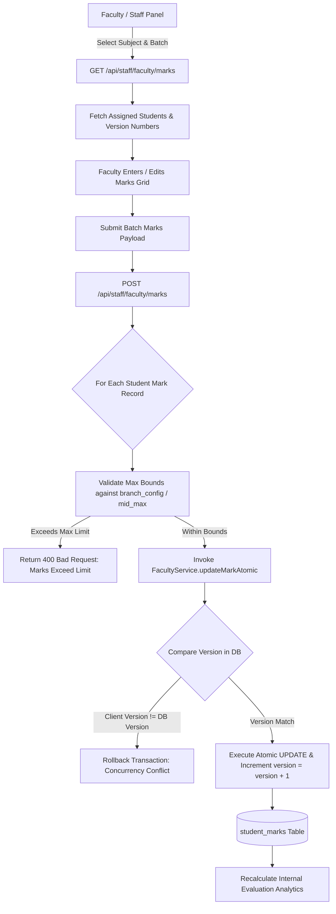
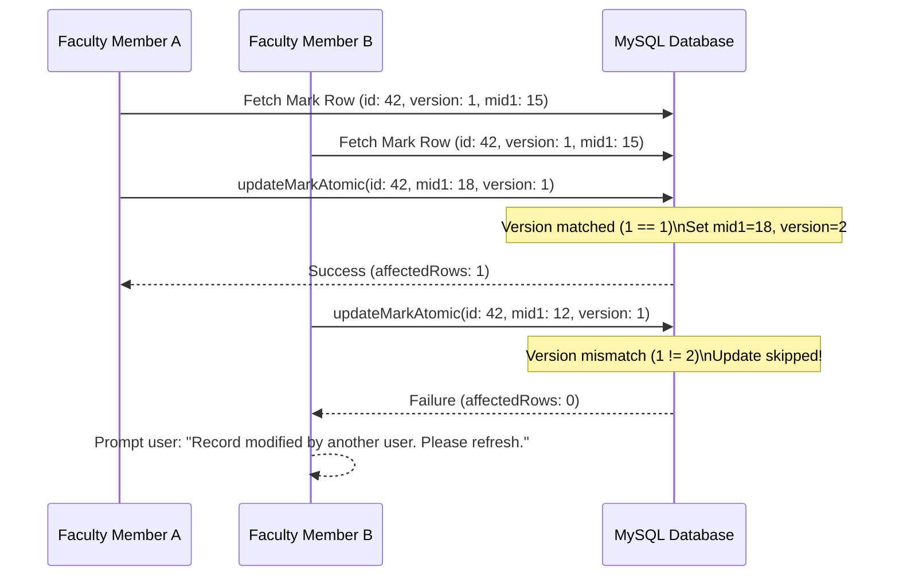

# Internal Marks & Evaluation System Documentation

## 1. Overview & Architectural Design

The **KUCET Internal Marks & Evaluation System** automates continuous internal assessment (CIE) tracking for all engineering departments. It handles Mid-term examinations (Mid 1 & Mid 2), continuous assignment evaluations, laboratory experiment scoring, optimistic concurrency locking, and automated departmental analytics.

The system enforces strict regulation rules (such as R22/R20 academic regulations) while ensuring concurrent mark entries by multiple teaching assistants or faculty members do not result in race conditions.



---

## 2. Semester Marks Entry & Component Breakdown

Continuous evaluation is divided into **Theory Subjects** and **Practical / Laboratory Subjects**.

### Schema Definition (`src/db/schema/operations.js`)

```javascript
// Source: src/db/schema/operations.js
export const studentMarks = mysqlTable('student_marks', {
  id: int('id').autoincrement().primaryKey().notNull(),
  student_id: int('student_id').notNull(),
  assignment_id: int('assignment_id').notNull(),
  is_published: boolean('is_published').default(true).notNull(),
  
  // Theory Components
  mid1_marks: decimal('mid1_marks', { precision: 5, scale: 2 }),
  mid2_marks: decimal('mid2_marks', { precision: 5, scale: 2 }),
  assignment_marks: decimal('assignment_marks', { precision: 5, scale: 2 }),
  
  // Practical / Laboratory Components
  lab_theory_marks: decimal('lab_theory_marks', { precision: 5, scale: 2 }),
  lab_execution_marks: decimal('lab_execution_marks', { precision: 5, scale: 2 }),
  lab_record_marks: decimal('lab_record_marks', { precision: 5, scale: 2 }),
  
  created_at: timestamp('created_at').defaultNow(),
  updated_at: timestamp('updated_at').onUpdateNow(),
  version: int('version').default(1).notNull(),
}, (table) => ({
  studentAssignmentIdx: index('idx_marks_student_assignment').on(table.student_id, table.assignment_id),
  studentAssignmentUniq: uniqueIndex('uq_marks_student_assignment').on(table.student_id, table.assignment_id),
}));
```

### Assessment Components & Weightages

| Subject Type | Component Name | Default Max Marks | Description / Purpose |
| :--- | :--- | :---: | :--- |
| **Theory** | `mid1_marks` | `20` or `30` | Mid-Semester Examination 1 written score. |
| **Theory** | `mid2_marks` | `20` or `30` | Mid-Semester Examination 2 written score. |
| **Theory** | `assignment_marks` | `5` or `10` | Continuous assignment / tutorial evaluation score. |
| **Practical** | `lab_theory_marks` | `10` | Day-to-day lab write-up / viva-voce evaluation. |
| **Practical** | `lab_execution_marks` | `25` | Practical program execution & output correctness. |
| **Practical** | `lab_record_marks` | `15` | Certified laboratory observation & record notebook marks. |

---

## 3. Departmental Theory Assessment Patterns & CIE Calculation

The system implements three university-approved assessment patterns defined in [`src/lib/evaluation-utils.js`](file:///run/media/admino/New%20Volume/User/Desktop/CMS/src/lib/evaluation-utils.js) and selected via `PatternSelectionModal.js`:

### Authoritative Assessment Patterns

| Pattern ID | Pattern Key | Mid Maximum | Assignment Maximum | Overall CIE Maximum | Description |
| :--- | :---: | :---: | :---: | :---: | :--- |
| `PATTERN_1` (`MID_20_ASSIGNMENT_10`) | `20_10` | 20 | 10 | **30** | Mid exams evaluate up to 20 marks. Assignment evaluates up to 10 marks. |
| `PATTERN_2` (`MID_25_ASSIGNMENT_5`) | `25_5` | 25 | 5 | **30** | Mid exams evaluate up to 25 marks. Assignment evaluates up to 5 marks. |
| `PATTERN_3` (`MID_30_ONLY`) | `30_0` | 30 | N/A | **30** | Mid exams evaluate up to 30 marks. Assignment is Not Applicable. |

### Continuous Internal Evaluation (CIE) Calculation Formula

In all three patterns, the overall CIE maximum is strictly capped at **30 marks**, and the Mid contribution is computed as the **Best of MID-1 and MID-2**:

$$\text{Best Mid Score} = \max(\text{Mid 1}, \text{Mid 2})$$

$$\text{Total Theory Internal Score} = \begin{cases} 
\text{Best Mid Score} + \text{Assignment Marks} & \text{(Patterns 1 & 2)} \\
\text{Best Mid Score} & \text{(Pattern 3)} 
\end{cases}$$

> [!NOTE]
> **Implementation Clarification**: Earlier technical documentation theorized a weighted average formula ($0.80 \times \max + 0.20 \times \min$). The actual codebase across both the backend (`evaluation-utils.js`) and frontend (`StudentAcademicsClient.js`, `AcademicTab.js`) strictly computes the **pure Best of Mid** ($\max(\text{Mid 1}, \text{Mid 2})$), which reflects actual Kakatiya University engineering academic practice.

### Practical Laboratory Evaluation Breakdown

Laboratory evaluation sums execution, viva/theory, and continuous record notebooks:

$$\text{Total Lab Internal Score} = \text{Execution Marks} + \text{Writing / Viva Marks} + \text{Record / Observation Marks}$$

- `lab_execution_marks`: Max 25 (program execution and practical outputs).
- `lab_theory_marks`: Max 10 or 25 (day-to-day write-up, theory, and viva-voce).
- `lab_record_marks`: Max 15 or 25 (observation book and certified laboratory record).

---

## 4. Version-Based Optimistic Locking (`updateMarkAtomic`)

To prevent data loss when multiple teaching assistants or faculty members edit the same section's marks grid simultaneously, the system uses **Optimistic Concurrency Control (OCC)** via `FacultyService.updateMarkAtomic`.

```javascript
// Source: src/services/academic/FacultyService.js
static async updateMarkAtomic(id, data, originalVersion, tx = db) {
  const result = await tx.update(studentMarks)
    .set({
      ...data,
      version: originalVersion + 1,
      updated_at: getNow()
    })
    .where(
      and(
        eq(studentMarks.id, id),
        eq(studentMarks.version, originalVersion) // Version check prevents race condition
      )
    );

  // If result.affectedRows === 0, another user updated the row concurrently
  return result.affectedRows > 0;
}
```



---

## 5. Internal Evaluation Analytics

The marks intelligence engine (`/api/intelligence/analytics/marks`) computes real-time performance analytics for Heads of Departments (HODs) and Principals:
- **Class Pass Percentage**: Percentage of students scoring $\ge 40\%$ in internal evaluation components.
- **Section Distribution**: Normal distribution histogram categorizing student scores into ranges (`90-100%`, `75-89%`, `60-74%`, `<60%`).
- **Low Performance Alerts**: Automated flagging of students with low combined attendance and mid-term marks for remedial classes.

### 5.1 Student Dashboard Internal Assessment Average (CIE)

The student portal dashboard features an authoritative continuous internal assessment summary card driven by [`calculateStudentCIE()`](file:///run/media/admino/New%20Volume/User/Desktop/CMS/src/lib/evaluation-utils.js):
- **Formula**:
  - Theory: $\text{Total} = \min(30, \max(\text{Mid 1}, \text{Mid 2}) + \text{Assignment})$ (or best of mids only if Pattern 3).
  - Practical / Lab: $\text{Total} = \text{Execution} + \text{Writing} + \text{Record}$ (max 30).
  - Average: $\frac{\sum \text{Evaluated Subject Totals}}{\text{Evaluated Subjects Count}}$.
- **Partial vs. Complete Indicator**: Clearly denotes evaluated subject count (e.g., "Partial Evaluation • 4 of 6 subjects") or pending state when marks have not yet been published.
- **Inviolable Display Invariant**: Explicitly labeled `Internal Assessment Average (CIE)`. Strictly accompanied by a disclaimer explaining that it measures college internal assessments and is NOT final university examination marks or university CGPA/SGPA.

---

## 6. Absence of External University Marks & Overall Marks Architecture

When evaluating student performance in the KUCET CMS, the following architectural boundaries are strictly observed:
1. **Continuous Internal Evaluation Only**: The database table `student_marks` stores internal assessment scores exclusively.
2. **External Examination Management**: End-semester external theory examinations and external lab viva evaluations are conducted centrally by the Kakatiya University Examination Branch (KU Campus, Warangal). External marks, grades, SGPA, and CGPA are published on external university result servers and are **NOT stored or synchronized within this database schema**.
3. **No Aggregate Overall Marks Service**: The application does not currently possess an overarching multi-semester marks aggregation engine or credit-weighted CGPA calculator. Any student dashboard display of overall marks must be carefully specified as subject-level CIE averages rather than official university degree grades.

---

## 7. Cross-References

- Proxy-Free Attendance System: [attendance.md](./attendance.md)
- Academic Archival & Grade Archival: [reports.md](./reports.md)
- Database Schemas: [schema.md](../database/schema.md)
- User Authentication: [authentication.md](../authentication/authentication.md)

