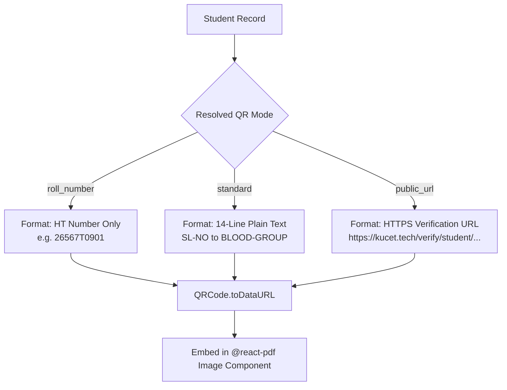
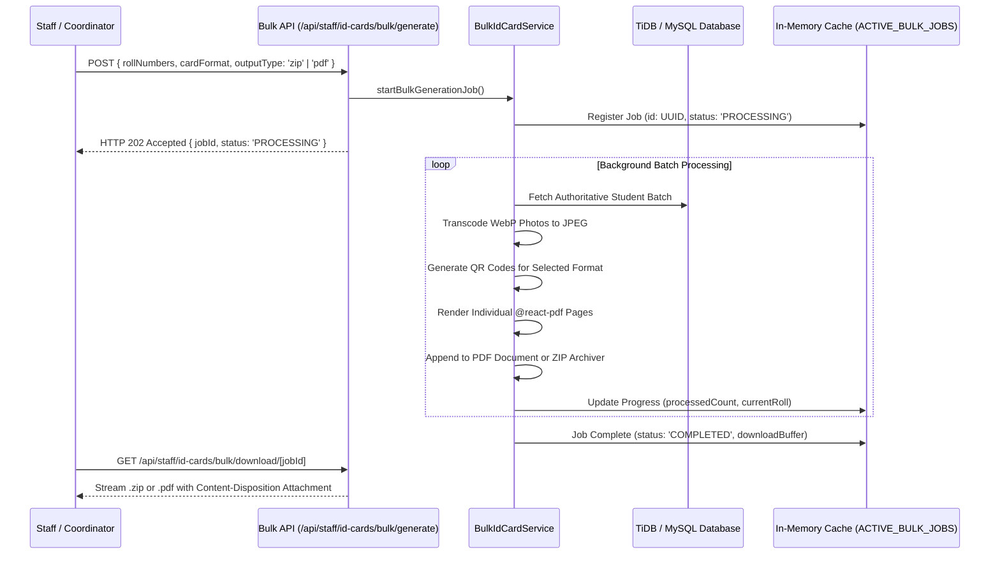

# Student ID Card Generation & Management Module

**Feature Name:** Reusable, Multi-Format Student ID Card Management & Bulk Generation  
**Last Updated:** Session 227 (Synchronized with 6 Formats, Official 2026 PNG Template, Asynchronous Bulk Engine & First-Year Coordinator Workspace)  
**Access Matrix:** **Admission Staff** (`/staff/admission/id-cards`), **First-Year Coordinator** (`/staff/first-year/id-cards`), **Super Admin / Principal** (`/admin/*`) via RBAC permissions (`ID_CARD_VIEW`, `ID_CARD_PREVIEW`, `ID_CARD_GENERATE`, `ID_CARD_BULK_GENERATE`, `ID_CARD_MANAGE_PHOTOS`).

---

## 1. Executive Summary & Core Architecture

The **Student ID Card Management Module** enables authorized college administrators, admission personnel, and academic coordinators to preview, rectify, verify, and generate physical identity cards for enrolled students of Kakatiya University College of Engineering and Technology (KUCET).

The module has been comprehensively upgraded to support:
1. **The Six Canonical Card Formats**: Unifies the original classic vector-rendered card and the official 2026 institutional PNG template across three distinct verification QR code modes (`roll_number`, `standard` 14-field, `public_url`).
2. **Asynchronous In-Memory Bulk Generation Engine**: Provides asynchronous batch processing of single-student PDFs, merged multi-page branch PDFs, and ZIP archives containing individualized student PDFs with live progress tracking.
3. **Official 2026 Institutional Template Integration**: Pixel-perfect layout geometry (`242pt x 385pt` vertical aspect ratio) overlaying student photographs, dynamic font-scaled typography, sanitized addresses, validated medical blood groups, and verification QR codes onto the official pre-printed college artwork.
4. **Zero-Duplicate Signature Architecture**: Preserves the authentic Principal signature already etched in the official background template while rendering dynamic signatures on classic layouts.
5. **Strict Authoritative Database Exclusivity**: Evaluates eligibility exclusively against the persistent relational tables (`students`, `student_personal_details`, `student_images`). Mock datasets and unfinalized admission drafts are strictly excluded.
6. **Multi-Role Scoped Workspaces**: Full operational parity across Admission Staff (`/staff/admission/id-cards`) and First-Year Coordinator (`/staff/first-year/id-cards`) consoles, enforced at both the Edge proxy (`src/proxy.js`) and API controller layers (`IDCardAuthorizationService`).

---

## 2. The Six Canonical ID Card Formats

The system implements the 6 official KUCET ID card formats defined in [`src/lib/id-card-formats.js`](file:///run/media/admino/New%20Volume/User/Desktop/CMS/src/lib/id-card-formats.js) and rendered via [`src/pdf/templates/IDCardPDF.js`](file:///run/media/admino/New%20Volume/User/Desktop/CMS/src/pdf/templates/IDCardPDF.js):

| Format Code | Format ID | Template Artwork | QR Code Mode | Target Badge | Description |
| :---: | :--- | :--- | :--- | :--- | :--- |
| **Format 1** | `classic_roll_number` | Classic Synthetic Vector | `roll_number` | Module A | Classic vector card encoding strictly the student's hall-ticket number. |
| **Format 2** | `classic_standard` | Classic Synthetic Vector | `standard` | 14 Fields | Classic vector card with comprehensive 14-line plain text student profile in QR. |
| **Format 3** | `classic_public_url` | Classic Synthetic Vector | `public_url` | Module B | Classic vector card with QR linking to the live KUCET student identification page. |
| **Format 4** | `official_roll_number` | Official 2026 PNG Template | `roll_number` | Official 2026 | New official template overlay encoding strictly the student's hall-ticket number. |
| **Format 5** | `official_standard` | Official 2026 PNG Template | `standard` | Official 2026 | New official template overlay with comprehensive 14-line plain text student profile in QR. |
| **Format 6** | `official_public_url` | Official 2026 PNG Template | `public_url` | Official 2026 | New official template overlay with QR linking to the live KUCET student identification page. |

### Format Resolution & Backward Compatibility
[`resolveIDCardFormat(formatKeyOrQrMode, explicitTemplate)`](file:///run/media/admino/New%20Volume/User/Desktop/CMS/src/lib/id-card-formats.js#L110) handles format identification from format IDs (`official_roll_number`), numeric codes (`1` through `6`), strings (`format_4`), or legacy QR mode keys (`standard`, `roll_number`, `public_url`), defaulting cleanly to `classic_standard` when unspecified.

---

## 3. QR Code Generation & Verification Workflows

The verification QR code is generated server-side using `qrcode` with error correction level `M`, a quiet zone margin of `2`, and high-contrast styling (`#000000` on `#ffffff`):



### 3.1 Mode 1: Roll Number Only (`roll_number` / Module A)
Generates a minimal QR payload containing strictly the student's authoritative uppercase roll number string (e.g. `26567T0901`). Optimized for high-throughput, low-latency mobile camera scanning in classroom attendance modules (`extractRollNumberFromQR`).

### 3.2 Mode 2: 14-Field Comprehensive Profile (`standard`)
Generates human-readable, labeled plain text without JSON formatting:
```text
SL-NO : 
HALL-TICKET-NO : 26567T0901
NAME : GOUTHAM RAO
FATHER-S-NAME : RAMESH RAO
COURSE : B.Tech (CSE)
ADDRESS : # 1-2-3, VIDYARANYAPURI, WARANGAL, TELANGANA - 506009
MOBILE-NO : 9876543210
VALID-UPTO- : 2030
BRANCH : CSE
ACADEMIC-YEAR : 2026-2030
ADMISSION-YEAR : 2026
COLLEGE-NAME : KU COLLEGE OF ENGINEERING & TECHNOLOGY
COLLEGE-ADDRESS : VIDYARANYAPURI, WARANGAL 506 009
BLOOD-GROUP : O+
```
- **Invariants**: Excludes internal primary keys (`id`), sensitive PII (Aadhaar, income, caste, religion), and never outputs `undefined`, `null`, or `N/A`.
- **Address Sanitization**: Collapses multi-line database addresses into a single comma-separated line.

### 3.3 Mode 3: Public Verification URL (`public_url` / Module B)
Generates an HTTPS URL directing to the live institutional verification page (`getPublicStudentUrl(student)`). Anyone scanning the card with an ordinary smartphone camera is routed directly to the public KUCET credential verification portal.

---

## 4. Student Photograph & Asset Pipeline

```mermaid
sequenceDiagram
    participant Client as UI / PDF Streamer
    participant Service as BulkIdCardService / IDCardDataService
    participant Storage as LocalStorageProvider / Cloudinary
    participant Sharp as Sharp Image Transcoder

    Client->>Service: Request Student ID Card PDF
    Service->>Storage: Resolve pfp key (kucet/students/pfp/UUID.webp)
    Storage-->>Service: Buffer / Local File
    Service->>Sharp: Transcode WebP -> Baseline JPEG (quality: 90)
    Sharp-->>Service: JPEG Buffer
    Service->>Service: Convert to data:image/jpeg;base64,...
    Service-->>Client: Stream PDF with Embedded Print-Ready Photo
```

1. **WebP to JPEG Transcoding**: KUCET CMS stores compressed photos as WebP. Because `@react-pdf/renderer` has limited WebP decoding support, the ID card engine automatically transcodes WebP photos into baseline JPEG data URLs (`sharp(buf).jpeg({ quality: 90 }).toBuffer()`) via [`resolvePdfImageDataUrl()`](file:///run/media/admino/New%20Volume/User/Desktop/CMS/src/app/api/staff/id-cards/%5Brollno%5D/pdf/route.js#L19).
2. **Containment & Geometry**:
   - **Format 4-6 (Official)**: Photo box is located at `top: 108pt`, `left: 19pt`, `width: 50pt`, `height: 58pt`, cleanly bounded above the template's red line at `168pt`. Photo uses `objectFit: cover` with a `0.8pt solid #334155` border.
   - **Format 1-3 (Classic)**: Photo box is `78pt x 98pt` at `objectFit: contain` with a `1.2pt solid #0b3578` border.
3. **Missing Photo Fallback**: Renders an accessible `NO PHOTO` indicator box in slate red without throwing rendering exceptions.
4. **Photo Rectification**: Authorized staff can upload or rectify missing student photos directly from the ID card hub (`POST /api/staff/id-cards/upload-photo`). Photos are validated (max 1MB, min 100x100px), converted to WebP, stored under `kucet/students/pfp/[uuid].webp`, persisted to `student_images.pfp`, and recorded in `auditLogs`.

---

## 5. Official 2026 Template Typography & Geometry Specifications

The official template layout (`242pt x 385pt`) overlays student data on the pre-printed PNG background (`public/assets/id-card-template-2026.png`):

```text
┌─────────────────────────────────────────────────────────────┐
│ [Official Background Template Art: Logo, Ribbon, Headers]   │
│                                                             │
│ ┌──────────┐   Course: B.Tech (CSE)                         │
│ │  Photo   │   H.T.No: 26567T0901                           │
│ │ 50x58 pt │   Academic Year: 2026-2030                     │
│ └──────────┘                                                │
│─────────────────────────────────────────────────────────────│ <-- Red Line (168pt)
│           GOUTHAM RAO (Dynamic Font Sizing)                 │
│           Father's Name: RAMESH RAO                         │
│                                                             │
│       ┌──────────┐                                          │
│       │ QR Code  │    [Pre-Printed Principal Signature]     │
│       │ 86x86 pt │                                          │
│       └──────────┘                                          │
│                                                             │
│   # 1-2-3, Vidyaranyapuri, Warangal, Telangana - 506009     │
│                                                             │
│ [Drop] O+                             Cell: 9876543210      │
└─────────────────────────────────────────────────────────────┘
```

### Specific Formatting Rules:
1. **Dynamic Name Font Scaling**: Student name is centered in an uppercase block (`top: 172pt`, `left: 20pt`, `width: 204pt`):
   - Length $> 34$ characters: `8.2pt`
   - Length $> 24$ characters: `9.2pt`
   - Default: `10.5pt` (Black weight, crimson `#d32f2f`).
2. **Father's Name**: Placed beside the pre-printed label (`top: 204pt`, `left: 110pt`), uppercase, with any duplicate `"Father's Name:"` prefix stripped.
3. **Address Wrapping & `#` Prefix**: Sanitized via [`sanitizeAddressString()`](file:///run/media/admino/New%20Volume/User/Desktop/CMS/src/lib/address-utils.js), guaranteed to begin with `# `, and dynamically scaled (`>95` chars: `6.5pt`, `>65` chars: `7.0pt`, default `7.6pt`) over a centered `214pt` bounding box.
4. **Strict Medical Blood Group Invariant**: Validated via [`sanitizeBloodGroup()`](file:///run/media/admino/New%20Volume/User/Desktop/CMS/src/lib/id-card-formats.js#L145). Returns strictly one of `['A+', 'A-', 'B+', 'B-', 'AB+', 'AB-', 'O+', 'O-']`. If invalid or unrecorded, it returns empty string `""` to prevent printing corrupted or erroneous medical data beside the pre-printed blood drop symbol.
5. **Zero-Duplicate Signature Architecture**: The official background template artwork already contains the authentic pre-printed Principal signature and seal. Formats 4, 5, and 6 strictly omit the dynamic signature overlay (`_signatureUrl`), eliminating duplicate signature defects. Formats 1, 2, and 3 continue to overlay the digital signature dynamically.

---

## 6. Asynchronous Bulk Generation Engine

Bulk operations are executed through the asynchronous job engine in [`src/services/admission/id-card/BulkIdCardService.js`](file:///run/media/admino/New%20Volume/User/Desktop/CMS/src/services/admission/id-card/BulkIdCardService.js):



### Supported Bulk Output Types:
1. **Consolidated Multi-Page PDF (`outputType: 'pdf'`)**: Compiles all requested student ID cards into a single multi-page PDF document, ideal for batch industrial card printers.
2. **Individualized ZIP Archive (`outputType: 'zip'`)**: Renders each student's card into an isolated PDF named `[ROLL_NO]_ID_CARD.pdf` and streams a compressed ZIP archive via `archiver`.
3. **One-Click Branch Dataset Export (`/api/staff/id-cards/export`)**: Streams complete branch-wide Excel (`.xlsx`) or `.csv` files containing the 11 verified card production fields without pagination truncation.

---

## 7. Role Permissions & Workspace Scoping

| Capability / Route | Super Admin / Principal | Admission Staff | First-Year Coordinator | HOD / Faculty | Student |
| :--- | :---: | :---: | :---: | :---: | :---: |
| Access `/staff/admission/id-cards` | ✅ | ✅ | ❌ | ❌ | ❌ |
| Access `/staff/first-year/id-cards` | ✅ | ❌ | ✅ | ❌ | ❌ |
| View Student ID Card Table (`ID_CARD_VIEW`) | ✅ | ✅ | ✅ (1st-Yr Only) | ❌ | ❌ |
| Interactive Card Preview (`ID_CARD_PREVIEW`) | ✅ | ✅ | ✅ | ❌ | ❌ |
| Single PDF Generation (`ID_CARD_GENERATE`) | ✅ | ✅ | ✅ | ❌ | ❌ |
| Asynchronous Bulk PDF / ZIP (`ID_CARD_BULK_GENERATE`) | ✅ | ✅ | ✅ | ❌ | ❌ |
| Upload & Rectify Photos (`ID_CARD_MANAGE_PHOTOS`) | ✅ | ✅ | ✅ | ❌ | ❌ |
| Request Replacement ID Card | ❌ | ❌ | ❌ | ❌ | ✅ (`/student/requests/id-card`) |

### First-Year Isolation Invariant
When accessed by the First-Year Coordinator, [`IDCardAuthorizationService`](file:///run/media/admino/New%20Volume/User/Desktop/CMS/src/services/identity/IDCardAuthorizationService.js) and [`IDCardDataService.isStudentFirstYear()`](file:///run/media/admino/New%20Volume/User/Desktop/CMS/src/services/identity/IDCardDataService.js#L688) enforce strict cohort boundary isolation:
- Verifies student roll number against entry year and lateral entry flags.
- Rejects requests for second, third, or fourth-year students with HTTP 403 Forbidden.

---

## 8. API Endpoint Reference

| Endpoint | Method | Required Permission | Description |
| :--- | :--- | :--- | :--- |
| `/api/staff/id-cards` | `GET` | `ID_CARD_VIEW` | Lists students with branch stats, photo readiness, and search |
| `/api/staff/id-cards/export` | `GET` | `ID_CARD_GENERATE` | Streams branch-wide `.xlsx` or `.csv` dataset |
| `/api/staff/id-cards/[rollno]` | `GET` | `ID_CARD_PREVIEW` | Retrieves single student details, resolved format & QR URL |
| `/api/staff/id-cards/[rollno]/pdf` | `GET` | `ID_CARD_GENERATE` | Streams single ID card PDF (`inline` or `attachment`) |
| `/api/staff/id-cards/bulk/preview` | `POST` | `ID_CARD_PREVIEW` | Validates bulk selection and returns photo/data readiness counts |
| `/api/staff/id-cards/bulk/generate` | `POST` | `ID_CARD_BULK_GENERATE` | Starts asynchronous bulk generation job (ZIP or merged PDF) |
| `/api/staff/id-cards/bulk/download/[jobId]` | `GET` | `ID_CARD_BULK_GENERATE` | Polls progress or streams completed bulk archive |
| `/api/staff/id-cards/bulk-pdf` | `POST` | `ID_CARD_BULK_GENERATE` | Synchronous legacy bulk PDF stream (backward compatibility) |
| `/api/staff/id-cards/upload-photo` | `POST` | `ID_CARD_MANAGE_PHOTOS` | Uploads and persists rectified student photograph |

*(Note: Identical route handlers are mirrored under `/api/staff/admission/id-cards/*` for admission staff routing).*

---

## 9. Feature Implementation Status Matrix

| Component / Requirement | Implementation Status | Verification Reference |
| :--- | :---: | :--- |
| 6 Canonical ID Card Formats | **Fully Implemented** | `src/lib/id-card-formats.js`, `src/pdf/templates/IDCardPDF.js` |
| 3 Verification QR Code Modes | **Fully Implemented** | `IDCardDataService.generateQRDataUrlForMode()` |
| Official 2026 PNG Template Artwork | **Fully Implemented** | `public/assets/id-card-template-2026.png`, `IDCardOfficialPage` |
| WebP to JPEG Transcoding | **Fully Implemented** | `resolvePdfImageDataUrl()` via `sharp` |
| Strict Blood Group Sanitization | **Fully Implemented** | `sanitizeBloodGroup()` (8 canonical groups or empty) |
| Dynamic Student Name Centering & Font Scaling | **Fully Implemented** | `officialNameBox` and `nameFontSize` logic in `IDCardPDF.js` |
| Address Prefix `# ` & Dynamic Typography | **Fully Implemented** | `sanitizeAddressString()` & `formatAddress()` |
| Zero Duplicate Signature Invariant | **Fully Implemented** | Dynamic signature omitted on Formats 4-6 |
| Asynchronous Bulk PDF & ZIP Engine | **Fully Implemented** | `BulkIdCardService.js`, `ACTIVE_BULK_JOBS` |
| Branch Dataset Export (`.xlsx` / `.csv`) | **Fully Implemented** | `/api/staff/id-cards/export` via `ExcelJS` |
| First-Year Coordinator Scoping | **Fully Implemented** | `isStudentFirstYear()`, `/staff/first-year/id-cards` |
| Admission Staff Scoping | **Fully Implemented** | `/staff/admission/id-cards` |
| Photo Rectification & Upload Modal | **Fully Implemented** | `POST /api/staff/id-cards/upload-photo`, `IDCardManagementHub.js` |
