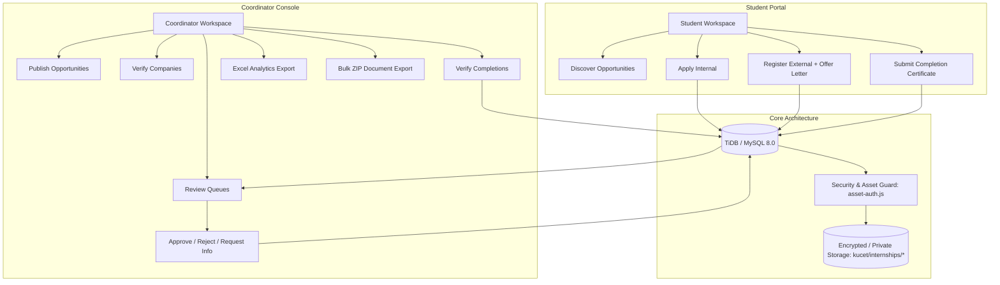

# Internship Management System & College-wide Coordinator Specification

## 1. Executive Overview & Institutional Purpose

The **Internship Management System** is a unified, production-grade module designed for Kakatiya University College of Engineering and Technology (KUCET). It orchestrates the end-to-end lifecycle of student internships across all institutional branches, from initial opportunity discovery and application through corporate verification, completion certificate auditing, and bulk document archival.

The system addresses two critical campus workflows:
1. **Student Internship Portal (`/student/internships`)**: Enables undergraduate students to browse verified campus opportunities, submit applications, register external self-sourced internships with mandatory offer letters, track multi-stage approvals, resubmit requested details, and upload completion certificates.
2. **College-wide Internship Coordinator Portal (`/staff/internship/dashboard`)**: Equips the institution's designated Internship Coordinator with comprehensive review queues, company directory management, opportunity authoring, live analytics, styled Excel reporting, and hierarchical bulk ZIP document exports.



---

## 2. Institutional Role: College-wide Internship Coordinator (`INTERNSHIP_COORDINATOR`)

### 2.1 Single Active Coordinator Invariant
Unlike Department Heads (HODs) who govern a single academic branch (e.g., `CSE`, `ECE`), there is **exactly one designated active Internship Coordinator** for the entire college.

- **College-wide Authority**: The coordinator possesses cross-branch jurisdiction to review and approve internships for all 7 engineering departments (`CSE`, `ECE`, `EEE`, `MECH`, `CIVIL`, `IT`, `MINING`).
- **Administrative Governance**: Only Super Administrators (`SUPER_ADMIN` / `ADMIN`) can designate or revoke the Internship Coordinator role via `/admin/institutional-roles`.
- **Automatic Superseding**: When a new coordinator is designated in `CoordinatorAssignmentService.assignCoordinator`, any existing active assignment with `coordinator_type: 'INTERNSHIP'` is automatically deactivated (`is_active: false`, `end_date: NOW()`), strictly preserving the single-coordinator invariant.
- **RBAC Matrix Alignment**: Mapped in `src/lib/rbac.js` to `INTERNSHIP_VIEW`, `INTERNSHIP_MANAGE`, `INTERNSHIP_APPROVE`, and `INTERNSHIP_REPORTS`.

```text
┌───────────────────────────────────────────────────────────────────────────────┐
│                     INTERNSHIP COORDINATOR INVARIANTS                         │
├───────────────────────────────────────────────────────────────────────────────┤
│ 1. Exactly ONE active college-wide coordinator across all branches.            │
│ 2. Designating a new coordinator automatically revokes prior assignment.       │
│ 3. Cross-branch jurisdiction: Sees records for all engineering departments.    │
│ 4. Completely isolated from the Student Achievements module.                  │
│ 5. Academic credit columns are forward-compatible and omitted from active UI. │
└───────────────────────────────────────────────────────────────────────────────┘
```

---

## 3. Student Internship Portal (`/student/internships`)

The student interface provides a clean, tabbed dashboard with live metric counters and responsive drawers:

### 3.1 Live Metric Counters & Tabbed Architecture
- **Tab 1: My Internships**: Full listing of student applications and external registrations with 11-status badges, stage chips (`UPCOMING`, `ONGOING`, `COMPLETED`), overlap warnings, withdrawal action, and completion submission modals.
- **Tab 2: Discover Opportunities**: Explore college-published opportunities with real-time branch, academic year, and CGPA eligibility calculation.
- **Tab 3: Apply Internal**: Streamlined internal application submission for college openings.
- **Tab 4: Register External**: Self-sourced internship registration form with pre-check date overlap warning, autocomplete company suggestions, and mandatory offer letter upload.
- **Tab 5: My Internship Documents**: Dedicated consolidated document repository listing all uploaded offer letters, joining letters, completion certificates, and reports across all internships with version history, verification badges, and secure file view links.

### 3.2 Canonical 11-Status State Machine
Every student internship is dynamically mapped via `computeCanonicalStatus` into one of 11 unified institutional states:
1. `DRAFT`: Draft application saved by student.
2. `SUBMITTED`: Submitted by student, awaiting coordinator queue intake.
3. `UNDER_REVIEW`: Actively being reviewed by the coordinator.
4. `APPROVED`: Formally approved by coordinator; internship start date is in the future.
5. `ONGOING`: Approved internship where the current calendar date falls within the start and end dates.
6. `COMPLETION_SUBMITTED`: Concluded internship where the student submitted employer completion certificate for review.
7. `COMPLETED`: Verified completed internship with authenticated completion certificate.
8. `CORRECTION_REQUESTED`: Flagged for resubmission (pre-approval info or post-completion docs).
9. `REJECTED`: Formally rejected during application review or completion certificate verification.
10. `WITHDRAWAL_REQUESTED`: Student has requested formal withdrawal; awaiting coordinator decision.
11. `WITHDRAWN`: Coordinator approved student withdrawal request; internship cancelled.

### 3.3 Date Overlap Detection & Non-Blocking Warnings
- **Engine (`StudentInternshipService.checkInternshipDateOverlaps`)**: Checks if specified start and end dates overlap with any of the student's existing active/approved internships.
- **Student Pre-Check API (`/api/student/internships/check-overlap`)**: Provides live UI feedback during external registration or internal application without blocking submission.
- **Coordinator Warning Banner**: Displays an amber warning badge (`⚠️ Date Overlap`) in review queues and modal details with overlap company and date details.

### 3.4 Student Withdrawal Workflow
Students may request formal withdrawal from any active or submitted internship:
1. Student clicks **Request Withdrawal** from the actions menu or detail view.
2. Prompts student for a mandatory withdrawal justification with an institutional warning that withdrawal cancels the internship.
3. Status transitions to `WITHDRAWAL_REQUESTED` and moves to the Coordinator's **Withdrawal Requests** review queue.
4. Coordinator can **Approve Withdrawal** (transitions to `WITHDRAWN`, internship status `CANCELLED`) or **Reject Withdrawal** (reverts application status to previous active state).

### 3.5 Opportunity Discovery Engine
Students can filter opportunities by search keyword, category, mode (`REMOTE`, `ON_SITE`, `HYBRID`), and eligibility:
- **Eligibility Engine (`InternshipOpportunityService.evaluateEligibility`)**:
  - Validates student's current branch against `eligible_branches` (or `'ALL'`).
  - Validates student's academic year/level against `eligible_academic_years` (or `'ALL'`).
  - Validates student's cumulative CGPA against `min_cgpa`.
  - Validates application deadline (`deadline >= NOW()`).
  - Checks if student has already applied to prevent duplicates.
  - Renders live visual indicators (`Eligible`, `Branch Mismatch`, `Low CGPA`, `Deadline Passed`, `Already Applied`).

### 3.3 Internal Application Workflow
1. Student clicks **Apply Now** on any eligible published opportunity.
2. Form captures optional cover letter / statement of purpose and portfolio link.
3. Record created in `student_internships` with `application_type: 'INTERNAL'`, status `SUBMITTED`.
4. Coordinator receives application in review queue.

### 3.4 External Self-Sourced Registration Workflow
1. Student registers an independently obtained off-campus internship.
2. Captures company name (with real-time autocomplete suggestions from verified companies), industry, job role, dates, duration, mode, location, stipend, supervisor contact, and work description.
3. **Mandatory Offer Letter**: System requires an uploaded offer letter (`.pdf`, `.png`, `.jpg`, max 10MB) before submission.
4. Auto-creates unverified company in `internship_companies` if not previously known.
5. Saves document via `StorageProvider` under `kucet/internships/${uuid}.${ext}`.

### 3.5 Action Required & Resubmission
When the coordinator requests additional details:
- Status transitions to `ADDITIONAL_INFO_REQUIRED`.
- Coordinator's remarks and specific instruction checklist are prominently displayed in the student dashboard.
- Student can edit dates, role, description, upload replacement documents, and click **Resubmit Application**.

### 3.6 Completion Verification Workflow
Upon concluding an approved internship:
1. Student accesses **Submit Completion** modal.
2. Captures actual start/end dates, student final report / summary, and learning outcomes rating (1-5).
3. **Mandatory Completion Certificate**: Student uploads signed institutional certificate from employer.
4. Document record created with `doc_type: 'COMPLETION_CERTIFICATE'`.
5. Status transitions to `COMPLETED_PENDING_VERIFICATION`.

---

## 4. Coordinator Portal (`/staff/internship/dashboard`)

The Coordinator Portal is restricted to the designated active Internship Coordinator, Principal, or Super Admin via `src/proxy.js` and `getAuthUser('internship_coordinator')`.

### 4.1 Tabbed Review Queues & 8 Queue Filters
The coordinator oversees all submissions through an intuitive filtering console (by Queue Type, Branch, Academic Year, and Student Search) supporting 8 distinct operational review queues:
- **All Active Submissions (`ALL`)**: Holistic view across all student internship records.
- **Pending Approvals (`PENDING_APPROVALS`)**: Submissions in `SUBMITTED` or `UNDER_REVIEW` awaiting decision.
- **Internal Applications (`INTERNAL_APPLICATIONS`)**: Submissions applied via college-published opportunities.
- **External Registrations (`EXTERNAL_REGISTRATIONS`)**: Self-sourced student registrations requiring employer validation.
- **Withdrawal Requests (`WITHDRAWAL_REQUESTS`)**: Active student requests to cancel/withdraw from internships.
- **Pending Completions (`PENDING_COMPLETIONS`)**: Concluded internships where completion certificate is uploaded.
- **Action Required (`ACTION_REQUIRED`)**: Submissions flagged for student corrections/resubmission.
- **Unverified Company Exceptions (`UNVERIFIED_COMPANY_EXCEPTIONS`)**: External applications from unverified corporate partners requiring coordinator academic review or exception justification.

### 4.2 Review Actions & State Machine
- **Approve**: Transitions status to `APPROVED`, allowing the student to begin work and later submit completion certificates.
- **Approve with Unverified Company Exception**: Allows approving an external internship with an unverified employer when the coordinator supplies a mandatory academic rationale; records `is_unverified_company_exception: true`, `unverified_company_exception_reason`, and timestamps to audit logs.
- **Reject**: Transitions status to `REJECTED` with mandatory justification recorded in `rejection_reason`.
- **Request Info / Correction**: Transitions status to `ADDITIONAL_INFO_REQUIRED` or `ADDITIONAL_DOCS_REQUESTED` with specific guidelines for the student.
- **Review Withdrawal**: Evaluates student withdrawal request; allows **Approve Withdrawal** (transitions to `WITHDRAWN`, internship status `CANCELLED`) or **Reject Withdrawal** (reverts application status to previous active state).
- **Verify Completion**: Transitions status to `VERIFIED_COMPLETED`, officially recording the verified internship.
- **Reject Completion**: Rejects invalid or unverified certificates with documented feedback.

### 4.3 Company Directory & Deduplication
- **Name Normalization (`InternshipCompanyService.normalizeName`)**: Strips noise words (`Pvt Ltd`, `LLC`, `Inc`, `Technologies`), trims whitespace, and converts to uppercase for deduplication.
- **Verification Engine**: Coordinator can mark companies as `VERIFIED` or `UNVERIFIED` with 1-click toggles.
- **Directory Search**: Real-time search across company name, industry, and location.

### 4.4 Opportunity Management
- Complete authoring console supporting:
  - Role Title, Description, Skills, Qualifications.
  - Eligibility Matrix: Multi-branch selector (`ALL` or specific branches), Academic Years, Minimum CGPA.
  - Duration, Mode, Location, Stipend, Openings Count, Application Deadline.
- Full state transitions: `DRAFT` ➔ `PUBLISHED` ➔ `UNPUBLISHED` ➔ `CLOSED` ➔ `ARCHIVED`.

### 4.5 Overview Metrics & Institutional 8 Reports
- **10 Overview KPI Cards**: Total Internships, Verified Partners, Published Openings, Pending Approvals, Ongoing Work, Pending Completions, Verified Completions, Withdrawal Requests, Unverified Exceptions, and Action Required.
- **8 Dedicated Institutional Reports**:
  1. `branch`: Department-wise internship distribution across all 7 engineering branches.
  2. `academic_year`: Batch-wise participation and progression metrics.
  3. `company`: Corporate recruitment volume, student count, and average stipend.
  4. `student`: Individual student comprehensive internship history.
  5. `status`: Distribution across canonical 11 lifecycle statuses.
  6. `completed`: Detailed audit of verified completed internships.
  7. `pending_verification`: Queue audit of certificates awaiting coordinator verification.
  8. `external`: Comparative analysis of external self-sourced vs campus-facilitated internships.
- **Multi-Format Export**:
  - Dynamic on-screen tabular preview with total summary.
  - CSV export via `/api/staff/internship/reports/export?reportType=...&format=csv`.
  - Styled Excel export via `/api/staff/internship/reports/export?reportType=...&format=xlsx` with Kakatiya Navy headers (`#0b3578`), gold accents, zebra striping, and auto-adjusted column widths.

### 4.6 Structured Bulk ZIP Export Engine
The coordinator can download all supporting documents in a single structured ZIP file (`InternshipDocumentService.generateBulkDocumentZip`):
- **Deterministic Folder Hierarchy**:
  ```text
  Internship_Documents_[ACADEMIC_YEAR]/
  ├── MANIFEST.csv
  ├── CSE/
  │   └── 21003T0901_Rahul_Sharma/
  │       ├── OFFER_LETTER_7a59662b.pdf
  │       └── COMPLETION_CERTIFICATE_9c41a23e.pdf
  └── ECE/
      └── 21003T0950_Priya_Patel/
          └── OFFER_LETTER_3d81b41a.pdf
  ```
- **Manifest File**: Root `MANIFEST.csv` containing Roll Number, Student Name, Branch, Academic Year, Company Name, Role, Document Type, Version, and Relative Storage Key.
- **Directory Traversal Guard**: Segment sanitization via `sanitizePathSegment` strips path traversal (`..`, `/`, `\`) and illegal filesystem characters.
- **Stream Compression**: Asynchronous ZIP streaming via `archiver` with compression level 6.
- **Audit Forensics**: Automatically logs user, branch, academic year, and document counts to `internship_audit_logs`.

---

## 5. Database Schema & Migrations (`0033` & `0034`)

The module introduces 5 dedicated relational tables in `src/db/schema/internships.js` tracked across migrations `0033_internship_management_system.sql` and `0034_internship_lifecycle_and_withdrawal.sql`:

### 5.1 `internship_companies`
Stores corporate partner registry and external employers.
- `id` (`INT`, PK, Auto-Increment)
- `company_name` (`VARCHAR(255)`, Not Null, Index: `idx_company_name`)
- `normalized_name` (`VARCHAR(255)`, Not Null, Unique Index: `uq_company_normalized_name`)
- `website` (`VARCHAR(255)`)
- `industry` (`VARCHAR(100)`)
- `location` (`VARCHAR(255)`)
- `contact_person`, `contact_email`, `contact_phone` (`VARCHAR(100)`)
- `verification_status` (`ENUM('VERIFIED', 'UNVERIFIED', 'BLACKLISTED')`, Default: `'UNVERIFIED'`)
- `verified_by_staff_id` (`INT`, FK ➔ `staff_accounts.id`)
- `created_at`, `updated_at` (`TIMESTAMP`)

### 5.2 `internship_opportunities`
Stores college-published openings.
- `id` (`INT`, PK, Auto-Increment)
- `company_id` (`INT`, FK ➔ `internship_companies.id`)
- `title` (`VARCHAR(255)`, Not Null)
- `description` (`TEXT`, Not Null)
- `category` (`VARCHAR(100)`)
- `required_skills`, `required_qualifications` (`TEXT`)
- `eligible_branches` (`JSON`, Default: `["ALL"]`)
- `eligible_academic_years` (`JSON`, Default: `["ALL"]`)
- `min_cgpa` (`DECIMAL(4,2)`)
- `start_date`, `end_date` (`DATE`)
- `duration` (`VARCHAR(50)`)
- `mode` (`ENUM('ON_SITE', 'REMOTE', 'HYBRID')`, Default: `'ON_SITE'`)
- `location` (`VARCHAR(255)`)
- `stipend` (`VARCHAR(100)`)
- `openings_count` (`INT`, Default: 1)
- `application_deadline` (`TIMESTAMP`)
- `status` (`ENUM('DRAFT', 'PUBLISHED', 'UNPUBLISHED', 'CLOSED', 'ARCHIVED')`, Default: `'DRAFT'`)
- `created_by_staff_id` (`INT`, FK ➔ `staff_accounts.id`)
- `created_at`, `updated_at` (`TIMESTAMP`)

### 5.3 `student_internships`
Primary lifecycle table for individual student internship records.
- `id` (`INT`, PK, Auto-Increment)
- `student_id` (`INT`, FK ➔ `students.id`, Index: `idx_si_student`)
- `opportunity_id` (`INT`, FK ➔ `internship_opportunities.id`, Nullable for external)
- `company_id` (`INT`, FK ➔ `internship_companies.id`, Nullable)
- `company_name` (`VARCHAR(255)`, Not Null)
- `role_title` (`VARCHAR(255)`, Not Null)
- `application_type` (`ENUM('INTERNAL', 'EXTERNAL')`, Not Null)
- `start_date`, `end_date` (`DATE`)
- `duration` (`VARCHAR(50)`)
- `mode` (`ENUM('ON_SITE', 'REMOTE', 'HYBRID')`, Default: `'ON_SITE'`)
- `location` (`VARCHAR(255)`)
- `stipend` (`VARCHAR(100)`)
- `academic_year` (`VARCHAR(20)`, Index: `idx_si_acad_year`)
- `semester` (`INT`)
- `application_status` (`ENUM('DRAFT', 'SUBMITTED', 'UNDER_REVIEW', 'ADDITIONAL_INFO_REQUIRED', 'APPROVED', 'REJECTED', 'WITHDRAWAL_REQUESTED', 'WITHDRAWN')`, Default: `'SUBMITTED'`, Index: `idx_si_app_status`)
- `stage` (`ENUM('UPCOMING', 'ONGOING', 'COMPLETED')`, Default: `'UPCOMING'`)
- `rejection_reason` (`TEXT`)
- `coordinator_remarks` (`TEXT`)
- `reviewed_by_staff_id` (`INT`, FK ➔ `staff_accounts.id`)
- `reviewed_at` (`TIMESTAMP`)
- `is_unverified_company_exception` (`BOOLEAN`, Default: false)
- `unverified_company_exception_reason` (`TEXT`)
- `unverified_company_exception_by` (`INT`, FK ➔ `staff_accounts.id`)
- `unverified_company_exception_at` (`TIMESTAMP`)
- `has_overlap_warning` (`BOOLEAN`, Default: false)
- `overlap_details` (`TEXT`)
- `withdrawal_reason` (`TEXT`)
- `withdrawal_requested_at` (`TIMESTAMP`)
- `withdrawal_reviewed_by` (`INT`, FK ➔ `staff_accounts.id`)
- `withdrawal_reviewed_at` (`TIMESTAMP`)
- `withdrawal_remarks` (`TEXT`)
- `completion_status` (`ENUM('NOT_STARTED', 'IN_PROGRESS', 'COMPLETED_PENDING_VERIFICATION', 'VERIFIED_COMPLETED', 'ADDITIONAL_DOCS_REQUESTED', 'REJECTED')`, Default: `'NOT_STARTED'`, Index: `idx_si_comp_status`)
- `completion_remarks` (`TEXT`)
- `verified_by_staff_id` (`INT`, FK ➔ `staff_accounts.id`)
- `verified_at` (`TIMESTAMP`)
- `student_feedback` (`TEXT`)
- `rating` (`INT`)
- `created_at`, `updated_at` (`TIMESTAMP`)

### 5.4 `internship_documents`
Tracks all uploaded offer letters, reports, and completion certificates.
- `id` (`INT`, PK, Auto-Increment)
- `internship_id` (`INT`, FK ➔ `student_internships.id`, Index: `idx_idoc_internship`)
- `document_type` (`ENUM('OFFER_LETTER', 'JOINING_LETTER', 'COMPLETION_CERTIFICATE', 'INTERNSHIP_REPORT', 'RECOMMENDATION_LETTER', 'OTHER_SUPPORTING_DOCUMENT')`, Not Null)
- `storage_key` (`VARCHAR(500)`, Not Null)
- `original_filename` (`VARCHAR(255)`, Not Null)
- `file_size_bytes` (`INT`)
- `mime_type` (`VARCHAR(100)`)
- `version` (`INT`, Default: 1)
- `is_current` (`BOOLEAN`, Default: true)
- `uploaded_by_type` (`ENUM('STUDENT', 'STAFF', 'ADMIN')`, Default: `'STUDENT'`)
- `uploaded_by_id` (`INT`, Not Null)
- `created_at` (`TIMESTAMP`)

### 5.5 `internship_audit_logs`
Immutable forensic audit trail for all coordinator and student mutations.
- `id` (`INT`, PK, Auto-Increment)
- `internship_id` (`INT`, Nullable)
- `opportunity_id` (`INT`, Nullable)
- `company_id` (`INT`, Nullable)
- `actor_type` (`ENUM('STUDENT', 'STAFF', 'ADMIN', 'SYSTEM')`, Not Null)
- `actor_id` (`INT`, Not Null)
- `action` (`VARCHAR(100)`, Not Null)
- `details` (`JSON`)
- `ip_address` (`VARCHAR(45)`)
- `user_agent` (`TEXT`)
- `created_at` (`TIMESTAMP`)

---

## 6. Security & Storage Model

1. **Storage Isolation**:
   - Files are stored using relative keys: `kucet/internships/${crypto.randomUUID()}.${ext}`.
   - Filenames never contain student roll numbers, names, or un-sanitized client strings.
2. **Access Control (`src/lib/asset-auth.js`)**:
   - Direct requests to `internships/` files are verified by `asset-auth.js`.
   - Access is permitted **only** to:
     - The student who owns the internship record.
     - The designated active Internship Coordinator.
     - The Principal.
     - Super Administrators.
   - All other staff members, faculty, or peer students receive an immediate `403 Forbidden`.
3. **Route Protection (`src/proxy.js`)**:
   - `/staff/internship/*` routes are protected at the edge proxy, allowing only users with `is_internship_coordinator`, `is_principal`, or admin payloads.

---

## 7. Cross-References

- [Database Schema Reference](../database/schema.md)
- [Database Migrations Guide](../database/migrations.md)
- [Staff Management & Institutional Roles](./staff-management.md)
- [Authentication & JWT Cookie Engine](../authentication/authentication.md)
- [Asset Storage Architecture](../architecture/storage.md)
