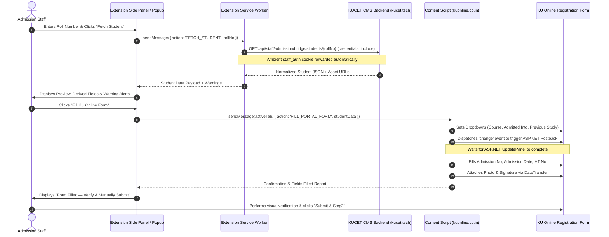

# KUCET Admission Bridge — Phase 1: API, Data Mapping & Integration Investigation Report

**Document Version:** 1.0.0 (Phase 1 Architectural Investigation)  
**Target Environment:** KUCET CMS (`testvanilla` branch) & KU Online Registration (`https://kuonline.co.in/BTechsql/Btechreg.aspx`)  
**Scope:** Data Modeling, Roll/Admission Derivations, Branch/Subject Scheme Mapping, API Contract & Manifest V3 Architecture  
**Author:** Antigravity AI Engineering & Solutions Architecture Team  
**Verification Date:** October 30, 2026  

---

## 1. Executive Summary & Feasibility Assessment

### 1.1 Executive Summary
The **KUCET Admission Bridge** project aims to streamline the transfer of admitted student records from the **KUCET College Management System (CMS)** into the Kakatiya University online student registration portal (`https://kuonline.co.in/BTechsql/Btechreg.aspx`). Currently, admission staff manually copy and re-type student details across browser tabs. 

This investigation confirms that the proposed Chrome extension integration is **technically feasible, architecturally sound, and achievable without making invasive changes to the production CMS**.

### 1.2 Key Feasibility Findings
1. **Authoritative Core Data Exists:** The KUCET CMS database maintains normalized, verified records for students across `students`, `student_academic_background`, `student_personal_details`, `student_images`, and `student_signatures`.
2. **Deterministic Number Derivations:** The College Admission Number derivation rule provided by the college (Regular = last 4 digits; Lateral-Entry = last 5 characters/digits) is directly supported by the canonical roll number grammar defined in [`src/lib/rollNumber.js`](file:///run/media/admino/New%20Volume/User/Desktop/CMS/src/lib/rollNumber.js) and [`src/lib/autoGenerateRollNumber.js`](file:///run/media/admino/New%20Volume/User/Desktop/CMS/src/lib/autoGenerateRollNumber.js).
3. **Roll Number IS the University Hall Ticket Number:** In Kakatiya University engineering registration, the student's official KUCET Roll Number (`26567T0332`) is functionally identical to the university's "Hall Ticket Number". This is confirmed by system ID card generation utilities and the provided university portal screenshot.
4. **Data Minimization Requirement:** The existing endpoint [`/api/staff/admission/students/[rollno]`](file:///run/media/admino/New%20Volume/User/Desktop/CMS/src/app/api/staff/admission/students/[rollno]/route.js) exposes decrypted Aadhaar numbers, guardian phone numbers, and full residential addresses. To protect student privacy and comply with zero-trust mandates, a dedicated, stripped-down endpoint (`GET /api/staff/admission/bridge/students/[rollno]`) must be established.
5. **Two Fields Require Human Confirmation:**
   - **Academic Scheme:** The portal displays `9999` and `2013`. The CMS does not store a legacy university scheme code; it stores AICTE Model Curriculum syllabi. Scheme selection must be flagged as `NEEDS CONFIRMATION / MANUAL REVIEW`.
   - **Branch CSD:** KUCET branch `CSD` (code `30`, Computer Science & Data Science) most likely corresponds to `DATA SCIENCE` on KU Online, but requires formal sign-off.
6. **File Upload Automation:** Programmatic file input population can be achieved using modern HTML5 `DataTransfer` within the extension content script, supplemented by a 1-click manual download fallback. Because CMS stores compressed images in `.webp` format and legacy ASP.NET Web Forms often mandate `.jpg` or `.png` under 250 KB, the bridge must transcode images during retrieval.

---

## 2. Actual CMS Schema & Authoritative Data Sources

The table below traces every required field from its authoritative database source to its API representation:

| Field Description | DB Table & Column | Data Type & Nullability | Actual Example Format | Source of Truth | Reliability | Validation / Normalization Required |
| :--- | :--- | :--- | :--- | :--- | :--- | :--- |
| **Roll Number** | `students.roll_no` | `varchar(255)` NOT NULL (Unique Index) | `26567T0332` (Regular) / `265670361L` (Lateral) | [`students`](file:///run/media/admino/New%20Volume/User/Desktop/CMS/src/db/schema/identity.js#L9) | Verified | Uppercase, trim whitespace, validate via [`validateRollNo()`](file:///run/media/admino/New%20Volume/User/Desktop/CMS/src/lib/rollNumber.js#L19). |
| **Admission Status** | `students.student_status` | `enum('ACTIVE','DISCONTINUED','INACTIVE_ATTENDANCE')` DEFAULT 'ACTIVE' | `'ACTIVE'` | [`students`](file:///run/media/admino/New%20Volume/User/Desktop/CMS/src/db/schema/identity.js#L25) | Verified | Must verify status is `'ACTIVE'` before initiating bridge transfer. |
| **Admission Year** | `student_admission_drafts.admission_year` or derived from `roll_no` | `varchar(9)` / Derived from first 2 digits | `'2026-2027'` or `'2026'` | [`rollNumber.js`](file:///run/media/admino/New%20Volume/User/Desktop/CMS/src/lib/rollNumber.js#L38) | Verified | Format to `YYYY-YYYY` (e.g., `2026-2027`) matching portal dropdown. |
| **Course / Programme** | Implicit institutional configuration | N/A (Hardcoded B.Tech in undergraduate registry) | `'B.TECH'` | Institutional Config | Verified | Constant `'B.TECH'`. |
| **Branch / Department** | Derived from `roll_no` (middle 2 digits) / `drafts.branch` | `varchar(50)` (e.g. `'03'` -> `'MECH'`) | `'MECH'`, `'CSE'`, `'CSD'` | [`branchCodes`](file:///run/media/admino/New%20Volume/User/Desktop/CMS/src/lib/rollNumber.js#L3) | Verified | Map KUCET branch code to KU Online dropdown label. |
| **Regular / Lateral Status** | Derived from `roll_no` pattern / `drafts.entrance_exam` | `'Regular'` vs `'Lateral'` | `'Regular'` or `'Lateral'` | [`validateRollNo()`](file:///run/media/admino/New%20Volume/User/Desktop/CMS/src/lib/rollNumber.js#L40) | Verified | Pattern check: presence of `T` vs trailing `L`. |
| **Previous Qualifying Education** | `student_academic_background.qualifying_exam` / `drafts.entrance_exam` | `varchar(50)` NULLABLE | `'TG EAPCET'` -> Inter / `'TG ECET'` -> Diploma | [`student_academic_background`](file:///run/media/admino/New%20Volume/User/Desktop/CMS/src/db/schema/registry.js#L56) | Derived | Derive `'Inter'` from TG EAPCET; `'Diploma'` from TG ECET. Mark `'Other'` if unlisted. |
| **College Admission Number** | `students.admission_no` (if populated) or derived from `roll_no` | `varchar(255)` NULLABLE | `'0332'` (Regular) / `'0361L'` (Lateral) | Derived Rule / [`students.admission_no`](file:///run/media/admino/New%20Volume/User/Desktop/CMS/src/db/schema/identity.js#L8) | Derived | Preserve leading zeroes. If `admission_no` is null in DB, calculate deterministically from `roll_no`. |
| **Qualifying Exam HT No** | Functionally identical to `students.roll_no` | `varchar(255)` | `26567T0332` | [`students.roll_no`](file:///run/media/admino/New%20Volume/User/Desktop/CMS/src/db/schema/identity.js#L9) | Verified | Portal sample demonstrates student roll number is entered here. |
| **Admission Date** | `students.admission_date` | `date` NULLABLE | `'2026-07-25'` | [`students.admission_date`](file:///run/media/admino/New%20Volume/User/Desktop/CMS/src/db/schema/identity.js#L21) | Verified | Convert MySQL `YYYY-MM-DD` to portal format `DD-MMM-YY` (e.g. `25-Jul-26`). |
| **Academic Scheme** | Not stored in CMS | N/A | `'2013'` or `'9999'` | External Portal Only | Not Available | **CANNOT be derived.** Must be set to `NEEDS CONFIRMATION`. |
| **Student Photo** | `student_images.pfp` | `text` (Relative storage path) | `'kucet/students/pfp/7a59662b.webp'` | [`student_images`](file:///run/media/admino/New%20Volume/User/Desktop/CMS/src/db/schema/registry.js#L144) | Verified | Serve authenticated stream; convert `.webp` to `.jpg`; ensure `< 250 KB`. |
| **Student Signature** | `student_signatures.signature` | `text` (Relative storage path) | `'kucet/students/signatures/91bf33a.webp'` | [`student_signatures`](file:///run/media/admino/New%20Volume/User/Desktop/CMS/src/db/schema/registry.js#L151) | Verified | Serve authenticated stream; convert `.webp` to `.jpg`; ensure `< 250 KB`. |

---

## 3. Student Roll Number & College Admission Number Rules

### 3.1 KUCET Roll Number Anatomy
As codified in [`src/lib/rollNumber.js`](file:///run/media/admino/New%20Volume/User/Desktop/CMS/src/lib/rollNumber.js) and [`src/lib/autoGenerateRollNumber.js`](file:///run/media/admino/New%20Volume/User/Desktop/CMS/src/lib/autoGenerateRollNumber.js):

```text
Regular B.Tech (TG EAPCET):
┌────┬─────┬───┬────┬────┐
│ 26 │ 567 │ T │ 03 │ 32 │  --> Total 10 characters
└────┴─────┴───┴────┴────┘
  │    │     │   │    └── Serial Number within branch (01-99, alphanumeric in legacy)
  │    │     │   └─────── Branch Code (03 = MECH, 09 = CSE, 30 = CSD, etc.)
  │    │     └─────────── Entrance Symbol ('T' = TG EAPCET Regular 4-Year Intake)
  │    └───────────────── College Code (567 = KUCET)
  └────────────────────── Admission Year Short (2026)

Lateral-Entry B.Tech (TG ECET):
┌────┬─────┬────┬────┬───┐
│ 26 │ 567 │ 03 │ 61 │ L │  --> Total 10 characters (or 11 if 'T' is present: 26567T0361L)
└────┴─────┴────┴────┴───┘
  │    │     │    │    └── Lateral Suffix ('L' = Diploma 2nd-Year Lateral Intake)
  │    │     │    └─────── Serial Number (typically continues sequence >= 61)
  │    │     └──────────── Branch Code (03 = MECH)
  │    └────────────────── College Code (567 = KUCET)
  └─────────────────────── Admission Year Short (2026)
```

### 3.2 College Admission Number Derivation Specification
The college rule states:
- **Regular students:** College Admission No = **last 4 digits** of the KUCET roll number.
- **Lateral-entry students:** College Admission No = **last 5 characters/digits** of the KUCET roll number.

#### Invariant Requirements:
1. **Preserve Leading Zeroes:** Leading zeroes must never be dropped (e.g., branch code `00` for Civil must yield `0001`, NOT `1`).
2. **String Types Only:** Do not parse or store admission numbers as JavaScript numbers or database integers.
3. **Format Validation Guard:** The roll number must pass strict regex validation before derivation begins.
4. **No Length-Only Inferences:** Never distinguish regular from lateral by string length, as both standard formats are 10 characters long (`26567T0332` vs `265670361L`).

### 3.3 Recommended Server-Side & Extension Shared Utility
```javascript
/**
 * Authoritatively derives the College Admission Number from a validated KUCET Roll Number.
 * 
 * @param {string} rollNo - Raw KUCET roll number
 * @returns {{ admissionNo: string, admissionType: 'Regular'|'Lateral', isValid: boolean, error?: string }}
 */
export function deriveCollegeAdmissionNo(rollNo) {
  if (!rollNo || typeof rollNo !== 'string') {
    return { admissionNo: null, admissionType: null, isValid: false, error: 'Roll number is required' };
  }

  const clean = rollNo.trim().toUpperCase();

  // Regular pattern: YY 567 T BB SS
  const regularPattern = /^(\d{2})567T(\d{2})([A-Z0-9]{2})$/;
  // Lateral pattern: YY 567 [T] BB SS L
  const lateralPattern = /^(\d{2})567T?(\d{2})([A-Z0-9]{2})L$/;

  const regMatch = clean.match(regularPattern);
  if (regMatch) {
    const [, _year, branchCode, serial] = regMatch;
    // Exactly 4 digits: branch code + serial
    const admissionNo = `${branchCode}${serial}`;
    return {
      admissionNo,
      admissionType: 'Regular',
      isValid: true,
    };
  }

  const latMatch = clean.match(lateralPattern);
  if (latMatch) {
    const [, _year, branchCode, serial] = latMatch;
    // 5 characters: branch code + serial + 'L'
    const admissionNo = `${branchCode}${serial}L`;
    return {
      admissionNo,
      admissionType: 'Lateral',
      isValid: true,
    };
  }

  return {
    admissionNo: null,
    admissionType: null,
    isValid: false,
    error: `Invalid KUCET roll number format: ${clean}`,
  };
}
```

---

## 4. Academic Scheme / Regulation Mapping

### 4.1 KU Online Portal Evidence & Institutional Confirmation
The university portal displays a mandatory `Scheme` dropdown containing:
- `9999`
- `2013`

When `2013` is selected in the screenshot example for a 1st-year Mechanical student, the portal dynamically populates a 14-subject table with 4-digit numeric codes:
`1101, 1102, 1103, 1104, 1105, 1106, 1107, 1108, 1111, 1112, 1113, 1114, 1115, 1116`.

### 4.2 Authoritative Business Confirmation
**Confirmed by KUCET Admission Staff:** For first-year regular B.Tech admissions in academic year 2026–2027 and future intakes, staff must select:
> **Scheme: `2013`**

This rule is now authoritatively confirmed and codified in [`ADMISSION_BRIDGE_CONFIG.DEFAULT_SCHEME`](file:///run/media/admino/New%20Volume/User/Desktop/CMS/src/lib/admission-bridge/config.js). The scheme is maintained as a configurable constant to allow smooth transition when new syllabus regulations are instituted.

---

## 5. Branch Mapping Table

KUCET CMS authoritatively defines 7 institutional engineering departments across [`src/lib/college-config.js`](file:///run/media/admino/New%20Volume/User/Desktop/CMS/src/lib/college-config.js) and [`src/lib/rollNumber.js`](file:///run/media/admino/New%20Volume/User/Desktop/CMS/src/lib/rollNumber.js). Below is the complete mapping to the KU Online options:

| KUCET CMS Branch | Branch Code | Full Department Name in CMS | KU Online Portal Option | Mapping Confidence | Architectural Notes |
| :--- | :---: | :--- | :--- | :--- | :--- |
| **CSE** | `09` | Computer Science & Engineering | `CSE` | **VERIFIED** | Exact 1:1 acronym match. |
| **CSD** | `30` | Computer Science & Data Science | `DATA SCIENCE` | **VERIFIED** | Confirmed by university administration: KUCET CSD students are officially registered under `DATA SCIENCE`. |
| **ECE** | `15` | Electronics & Communication Engineering | `ECE` | **VERIFIED** | Exact 1:1 acronym match. |
| **EEE** | `12` | Electrical & Electronics Engineering | `EEE` | **VERIFIED** | Exact 1:1 acronym match. |
| **CIVIL** | `00` | Civil Engineering | `CIVIL` | **VERIFIED** | Exact match. Leading zero preserved in code. |
| **IT** | `18` | Information Technology | `IT` | **VERIFIED** | Exact 1:1 acronym match. |
| **MECH** | `03` | Mechanical Engineering | `MECHANICAL` | **VERIFIED** | CMS uses abbreviation `MECH`; KU Online portal uses full word `MECHANICAL`. |
| — | — | *E&I* | `E&I` | N/A | Not offered at KUCET campus. |
| — | — | *Mining* | `MINING` | N/A | Offered at KU Kothagudem campus, not KUCET main campus. |
| — | — | *Production* | `PRODUCTION` | N/A | Not offered at KUCET. |

---

## 6. Previous Studying Mapping

### 6.1 KU Online Portal Options
- `Inter`
- `Diploma`
- `Other`

### 6.2 CMS Storage Analysis
In KUCET CMS:
- In `student_admission_drafts`: Stored as `entrance_exam` (`'TG EAPCET'`, `'TG ECET'`, `'PGECET'`, `'Other'`).
- In `student_academic_background`: Stored as `qualifying_exam` (`varchar(50)`), populated from `entrance_exam` during finalization.
- In `students`: Derived from `roll_no` structure (`validateRollNo`).

### 6.3 Deterministic Conversion Rules
```text
┌───────────────────────────────────────┬──────────────────────┬─────────────────────────┐
│ CMS Data / Roll Number Signature      │ KU Online Dropdown   │ Confidence              │
├───────────────────────────────────────┼──────────────────────┼─────────────────────────┤
│ entrance_exam === 'TG EAPCET' OR      │ Inter                │ DERIVED (High)          │
│ rollNo matches regular pattern (*T*)  │                      │                         │
├───────────────────────────────────────┼──────────────────────┼─────────────────────────┤
│ entrance_exam === 'TG ECET' OR        │ Diploma              │ DERIVED (High)          │
│ rollNo matches lateral pattern (*L)   │                      │                         │
├───────────────────────────────────────┼──────────────────────┼─────────────────────────┤
│ entrance_exam in ('Other', 'PGECET')  │ Other                │ NEEDS CONFIRMATION      │
│ or qualifying_exam is unmapped        │                      │                         │
└───────────────────────────────────────┴──────────────────────┴─────────────────────────┘
```
**Defensive Guardrail:** While regular students almost universally possess Intermediate certificates and lateral students possess State Board Diplomas, students from CBSE/ICSE or external boards must be flagged for staff review to confirm whether Kakatiya University categorizes them as `Inter` or `Other`.

---

## 7. Admission Date & Hall Ticket Number Findings

### 7.1 Admission Date
1. **CMS Storage:** Stored as MySQL `date` in `students.admission_date` and `student_admission_drafts.admission_date`.
2. **Format in CMS:** Standard ISO `YYYY-MM-DD` (e.g., `2026-07-25`).
3. **Format on KU Online:** The screenshot displays `25-Jul-26` (`DD-MMM-YY`).
4. **Transformation:**
   ```javascript
   function formatToPortalDate(isoDateStr) {
     if (!isoDateStr) return '';
     const date = new Date(isoDateStr);
     if (isNaN(date.getTime())) return '';
     const day = String(date.getDate()).padStart(2, '0');
     const months = ['Jan','Feb','Mar','Apr','May','Jun','Jul','Aug','Sep','Oct','Nov','Dec'];
     const month = months[date.getMonth()];
     const yearShort = String(date.getFullYear()).slice(-2);
     return `${day}-${month}-${yearShort}`;
   }
   ```

### 7.2 Hall Ticket Number
1. **Portal Requirement:** The KU Online page features a "Hall Ticket Number" field.
2. **Authoritative Finding:** The example value in the portal screenshot is `26567T0332`. This format matches the KUCET Student Roll Number (`students.roll_no`).
3. **Institutional Verification:** In Telangana university engineering admissions, the university examination roll number assigned to an admitted student serves as their permanent university hall ticket number for all future semester examinations.
4. **Entrance Exam HT No Distinction:** CMS does not track the previous entrance examination (TG EAPCET / TG ECET) admit card number. The portal field expects the **assigned KUCET Roll Number**.

---

## 8. Student Photo & Signature Storage, Optimization & Delivery Architecture

### 8.1 Existing Storage Locations & Delivery APIs
- **Profile Photo (PFP):**
  - **Table & Column:** `student_images.pfp` (`text`), keyed by `student_id`.
  - **Storage Paths:** Canonical key `students/pfp/{uuid}.webp` (or prefixed `kucet/students/pfp/{uuid}.webp`).
  - **Draft/Staging Path:** `admission_drafts/pfp/{uuid}.webp` in `student_admission_drafts.pfp`. Promoted atomically upon admission finalization via [`MediaPromotionService.promoteAdmissionMedia()`](file:///run/media/admino/New%20Volume/User/Desktop/CMS/src/services/storage/MediaPromotionService.js#L258).
- **Signature:**
  - **Table & Column:** `student_signatures.signature` (`text`), keyed by `student_id`.
  - **Storage Paths:** Canonical key `students/signatures/{uuid}.webp` (or `kucet/students/signatures/{uuid}.webp`).
  - **Draft/Staging Path:** `admission_drafts/signatures/{uuid}.webp` in `student_admission_drafts.signature`.
- **Serving Routes:**
  - [`/api/assets/view/[...path]`](file:///run/media/admino/New%20Volume/User/Desktop/CMS/src/app/api/assets/view/[...path]/route.js): Main static/dynamic asset proxy. Requires an authenticated active staff or student session; enforces role-based checks via [`canUserAccessAsset()`](file:///run/media/admino/New%20Volume/User/Desktop/CMS/src/lib/asset-auth.js).
  - [`/api/student/image/[rollno]`](file:///run/media/admino/New%20Volume/User/Desktop/CMS/src/app/api/student/image/[rollno]/route.js): Serves profile image for any authenticated session.
  - **Gap Identified:** No dedicated, authenticated endpoint exists to retrieve a student's *signature* by roll number for admission staff.

### 8.2 Image Formats, Dimensions & CMS Upload Characteristics
1. **Source Formats in CMS:**
   - Client upload pipelines across [`src/app/admission/page.js`](file:///run/media/admino/New%20Volume/User/Desktop/CMS/src/app/admission/page.js#L358), [`src/app/student/settings/edit-profile/page.js`](file:///run/media/admino/New%20Volume/User/Desktop/CMS/src/app/student/settings/edit-profile/page.js#L270), and [`src/components/staff/student-management/AddNewStudent.js`](file:///run/media/admino/New%20Volume/User/Desktop/CMS/src/components/staff/student-management/AddNewStudent.js#L129) invoke [`compressImage()`](file:///run/media/admino/New%20Volume/User/Desktop/CMS/src/lib/image-compressor.js#L11), which outputs **WebP (`image/webp`)**.
   - However, legacy records, bulk imports, and direct API submissions may store standard **JPEG (`image/jpeg`)**, **PNG (`image/png`)**, or base64 data URIs.
2. **Dimensions:**
   - CMS client compression caps dimensions at `1200 x 1200 px` with `quality = 0.6`.
   - Photographs: Typically 3:4 portrait aspect ratio (e.g. `900 x 1200 px` or `600 x 800 px`).
   - Signatures: Typically horizontal aspect ratio (e.g. `1200 x 400 px` or `800 x 300 px`).
3. **Byte Sizes:**
   - WebP files in CMS typically range between `40 KB` and `220 KB`.
   - However, uncompressed JPEGs or PNGs from bulk uploads can be up to `1 MB` (`UPLOAD_LIMITS.IMAGE_MAX_BYTES = 1,048,576 bytes`).
4. **Format Incompatibility with KU Online:**
   - KU Online is an ASP.NET Web Forms application that mandates:
     > *"photo & signature should be in 250K Below"*
   - ASP.NET Web Forms file handling validators on Indian university registration portals historically reject `.webp` extensions and mime types, expecting `.jpg` / `.jpeg` (or rarely `.png`).
   - Furthermore, converting WebP to JPEG increases file size by 30%–60% due to WebP's superior compression efficiency. A 180 KB WebP can become a 290 KB JPEG at default encoding quality, breaching the portal ceiling.
   - **Conservative Safety Margin:** To guarantee acceptance without boundary rejection and protect against unconfirmed server-side limits, the pipeline enforces a **conservative hard ceiling of 190 KiB (194,560 bytes)** for both photographs and signatures.

### 8.3 Reusability of Existing CMS Utilities
- [`src/lib/image-compressor.js`](file:///run/media/admino/New%20Volume/User/Desktop/CMS/src/lib/image-compressor.js) demonstrates the viability of browser-native Canvas compression.
- However, the existing utility:
  - Hardcodes output to `image/webp` (which KU Online does not accept).
  - Uses a single fixed quality pass (`0.6`) without verifying whether the resulting file satisfies a target byte size constraint.
  - Does not guarantee output strictly below 190 KiB or target the 100–150 KB range.
- **Verdict:** The concept (HTML5 Canvas 2D + `toBlob`) is reusable, but requires a dedicated, iterative, multi-pass compression engine designed specifically for the extension.

### 8.4 Recommended Browser-Native Compression Engine
To ensure high speed, zero external library overhead, and complete privacy (no third-party cloud processing), the extension will use a pure **browser-native Canvas & Blob optimization pipeline** executing within the Extension Side Panel.

#### Multi-Pass Iterative Optimization Algorithm:
```text
┌────────────────────────────────────────────────────────────────────────┐
│                        IMAGE OPTIMIZATION PIPELINE                     │
├────────────────────────────────────────────────────────────────────────┤
│ 1. FETCH & INSPECT                                                     │
│    - Fetch Blob via authenticated CMS Bridge API                       │
│    - Record initial format, byte size, and dimensions                  │
│                                                                        │
│ 2. PRESERVATION CHECK                                                  │
│    - If format is JPEG AND byte size <= 194,560 bytes AND >= 80 KB:    │
│      --> Preserve original file as-is (Zero unnecessary re-encoding)   │
│                                                                        │
│ 3. DECODE TO CANVAS                                                    │
│    - Load image into ImageBitmap / HTMLImageElement                    │
│    - Calculate aspect-ratio-preserving dimensions                      │
│    - Initial bounds: max dimension 1000px (photo) / 800px (signature)  │
│                                                                        │
│ 4. ITERATIVE QUALITY TUNING (Pass 1 - Dimensions Constant)             │
│    - Target range: 100 KB - 150 KB (Conservative ceiling: 190 KiB)    │
│    - Binary search / step-down quality: 0.85 -> 0.75 -> 0.65 -> 0.45   │
│    - Export: canvas.toBlob(cb, 'image/jpeg', q)                        │
│    - Check blob.size after each iteration                              │
│                                                                        │
│ 5. DIMENSION REDUCTION (Pass 2 - Only if Pass 1 quality < 0.45)        │
│    - If quality adjustment reaches 0.35 and size > 194,560 bytes:      │
│      Scale canvas dimensions down by 0.80x                             │
│      Reset quality to 0.65 and re-evaluate                             │
│    - Enforce minimum dimensions (Photo: 240px; Sig: 160px)             │
│                                                                        │
│ 6. HARD BYTE VERIFICATION                                              │
│    - Final assert: outputBlob.size <= 194,560 bytes (190 KiB)          │
│    - If violated: throw CompressionConstraintError                     │
│                                                                        │
│ 7. RESOURCE RELEASE                                                    │
│    - Revoke previous object URLs via URL.revokeObjectURL()             │
│    - Clear canvas buffer                                               │
└────────────────────────────────────────────────────────────────────────┘
```

#### Shared Extension Compression Implementation:
```javascript
/**
 * Browser-native image optimizer for KU Online registration portal.
 * Guaranteed output: JPEG format, strictly < 250 KB, targeting 100-150 KB.
 * 
 * @param {Blob} sourceBlob - Original image blob from CMS
 * @param {'photo' | 'signature'} category - Image classification
 * @param {string} filename - Base filename for the output
 * @returns {Promise<{ file: File, originalSize: number, optimizedSize: number, quality: number, width: number, height: number }>}
 */
export async function optimizeForPortal(sourceBlob, category = 'photo', filename = 'upload.jpg') {
  const originalSize = sourceBlob.size;
  const isJpeg = sourceBlob.type === 'image/jpeg' || sourceBlob.type === 'image/jpg';

  // If already compliant JPEG between 80 KB and 245 KB, preserve original
  if (isJpeg && originalSize <= 245 * 1024 && originalSize >= 80 * 1024) {
    return {
      file: new File([sourceBlob], filename, { type: 'image/jpeg' }),
      originalSize,
      optimizedSize: originalSize,
      quality: 1.0,
      preserved: true
    };
  }

  // Decode image
  const imgBitmap = await createImageBitmap(sourceBlob);
  let curWidth = imgBitmap.width;
  let curHeight = imgBitmap.height;

  // Max initial dimension bounds (preserves aspect ratio)
  const MAX_INITIAL_DIM = category === 'photo' ? 1000 : 800;
  if (curWidth > MAX_INITIAL_DIM || curHeight > MAX_INITIAL_DIM) {
    const ratio = Math.min(MAX_INITIAL_DIM / curWidth, MAX_INITIAL_DIM / curHeight);
    curWidth = Math.round(curWidth * ratio);
    curHeight = Math.round(curHeight * ratio);
  }

  const canvas = document.createElement('canvas');
  const ctx = canvas.getContext('2d', { alpha: false }); // JPEG does not need alpha

  const renderToBlob = (w, h, q) => new Promise((resolve) => {
    canvas.width = w;
    canvas.height = h;
    // Fill white background for signatures with transparent backgrounds
    ctx.fillStyle = '#FFFFFF';
    ctx.fillRect(0, 0, w, h);
    ctx.drawImage(imgBitmap, 0, 0, w, h);
    canvas.toBlob(resolve, 'image/jpeg', q);
  });

  const TARGET_MIN_BYTES = 100 * 1024; // 100 KB
  const TARGET_MAX_BYTES = 150 * 1024; // 150 KB
  const ABSOLUTE_MAX_BYTES = 245 * 1024; // 245 KB safety margin below 250 KB

  let bestBlob = null;
  let bestQuality = 0.80;
  let attempts = 0;
  const MAX_ATTEMPTS = 8;

  // Quality range candidates
  const qualityCandidates = category === 'photo' 
    ? [0.85, 0.75, 0.65, 0.55, 0.45] 
    : [0.90, 0.80, 0.70, 0.60, 0.50]; // Signatures require higher contrast/quality

  for (const q of qualityCandidates) {
    attempts++;
    const candidateBlob = await renderToBlob(curWidth, curHeight, q);
    
    if (candidateBlob.size <= ABSOLUTE_MAX_BYTES) {
      bestBlob = candidateBlob;
      bestQuality = q;
      // If we landed in the sweet spot (100KB-150KB), stop immediately
      if (candidateBlob.size <= TARGET_MAX_BYTES && candidateBlob.size >= TARGET_MIN_BYTES) {
        break;
      }
      // If below 100KB on the highest quality, it's small but acceptable
      if (candidateBlob.size < TARGET_MIN_BYTES && q === qualityCandidates[0]) {
        break;
      }
    }
  }

  // If still above 245 KB after lowest quality candidate, step down dimensions
  while ((!bestBlob || bestBlob.size > ABSOLUTE_MAX_BYTES) && attempts < MAX_ATTEMPTS) {
    attempts++;
    curWidth = Math.round(curWidth * 0.80);
    curHeight = Math.round(curHeight * 0.80);
    
    // Stop scaling down if dimensions become too degraded
    const minDim = category === 'photo' ? 240 : 160;
    if (curWidth < minDim || curHeight < minDim) break;

    const candidateBlob = await renderToBlob(curWidth, curHeight, 0.70);
    if (candidateBlob.size <= ABSOLUTE_MAX_BYTES) {
      bestBlob = candidateBlob;
      bestQuality = 0.70;
      break;
    }
  }

  // Clean up bitmap memory
  imgBitmap.close();

  // Final hard verification against conservative ceiling
  if (!bestBlob || bestBlob.size > 194560) {
    throw new Error(
      `Image compression failed: unable to reduce ${category} below conservative safe upload limit of 190 KiB / 194,560 bytes (Final: ${(bestBlob?.size / 1024).toFixed(1)} KB).`
    );
  }

  const finalFile = new File([bestBlob], filename, {
    type: 'image/jpeg',
    lastModified: Date.now()
  });

  return {
    file: finalFile,
    originalSize,
    optimizedSize: finalFile.size,
    quality: bestQuality,
    width: curWidth,
    height: curHeight,
    preserved: false
  };
}
```

### 8.5 Safe Delivery to the KU Online Portal
Because browsers prevent programmatic setting of arbitrary file paths on `<input type="file">`, the bridge employs a **validated dual-delivery strategy**:

1. **Automated Attachment via `DataTransfer`:**
   In the active tab content script context, once the optimized `File` object is generated in the side panel, it is transferred to the content script using Chrome messaging (as an ArrayBuffer) and reconstructed:
   ```javascript
   const dataTransfer = new DataTransfer();
   dataTransfer.items.add(optimizedFile);
   
   const fileInput = document.querySelector('input[type="file"][id*="Photo"], input[type="file"][name*="Photo"]');
   if (fileInput) {
     fileInput.files = dataTransfer.files;
     fileInput.dispatchEvent(new Event('change', { bubbles: true }));
     
     // KU Online includes an accompanying checkbox for photo/signature
     const photoCheckbox = document.querySelector('input[type="checkbox"][id*="Photo"], input[type="checkbox"][name*="Photo"]');
     if (photoCheckbox && !photoCheckbox.checked) {
       photoCheckbox.checked = true;
       photoCheckbox.dispatchEvent(new Event('change', { bubbles: true }));
     }
   }
   ```
2. **One-Click Manual Fallback (100% Guaranteed):**
   If the target ASP.NET Web Forms postback validates files strictly against browser native user gestures or blocks `DataTransfer` assignment, the Extension Side Panel provides:
   - A `Download Optimized Photo` button (downloads `{roll_no}_photo.jpg`, ~120 KB).
   - A `Download Optimized Signature` button (downloads `{roll_no}_signature.jpg`, ~90 KB).
   - Staff can simply click the portal's native "Choose File" button and pick the freshly saved file from their Downloads folder.

### 8.6 Staff Verification & Live Preview UI
The Extension Side Panel UI will render dedicated photo and signature preview cards:
- **Image Thumbnail:** Crisp, zoomable preview allowing staff to visually inspect clarity, contrast, and framing.
- **Metric Badges & Staff Feedback:**
  - *Status:* `Ready — 142 KB` (Green, within conservative 190 KiB ceiling)
  - *Needs Attention:* `Needs attention — exceeds safe upload limit`
- **Safety Lock:** The "Fill Portal Form" and "Download Files" buttons are locked if either file exceeds the conservative 190 KiB (194,560 bytes) ceiling.

### 8.7 Error Handling & Edge Cases
1. **Uncompressible High-Entropy Images:** If an image cannot be reduced below 190 KiB without scaling below minimum acceptable dimensions (`240px`), the engine halts with a descriptive error: `IMAGE_QUALITY_FLOOR_EXCEEDED`. Staff are prompted to inspect the original student document in CMS.
2. **Corrupted or Unsupported Files:** If `createImageBitmap` throws a decoding error, the extension catches it, displays `UNREADABLE_IMAGE_FILE`, logs the error to the local extension console, and does not alter the portal form.
3. **Transparent Signatures:** Signatures scanned as transparent PNGs or WebPs are composited over a solid white background (`#FFFFFF`) before JPEG encoding, preventing transparent pixels from turning black.
4. **Zero CMS Mutation Invariant:** All compression operations take place exclusively in browser memory. The original student media stored in CMS (`student_images` and `student_signatures`) is **never modified, replaced, or deleted**.

---

## 9. Existing CMS APIs & Authentication Inventory

An audit of existing API routes reveals that no current route satisfies the extension's requirements with appropriate data minimization:

| Endpoint | Method | Auth & Role | Scope / Limitations | Suitable for Extension? |
| :--- | :---: | :--- | :--- | :---: |
| `/api/staff/admission/students/[rollno]` | `GET` | Staff (`admission`, `scholarship`, `admin`) | Returns entire student record, including **decrypted Aadhaar, decrypted guardian phone, residential address, fee payments, and scholarship sanctions**. | **NO** (Violates data minimization) |
| `/api/staff/students/[rollno]` | `GET` | Generic Staff (`staff`) | Returns full student profile via [`StudentService.getStudentProfile()`](file:///run/media/admino/New%20Volume/User/Desktop/CMS/src/services/identity/StudentService.js#L121). Includes sensitive PII. | **NO** (Excessive PII exposure) |
| `/api/student/image/[rollno]` | `GET` | Any authenticated user | Returns profile picture stream. Does not support signature retrieval by roll number. | **Partial** (PFP only) |
| `/api/student/signature` | `GET` | Student only (`auth: 'student'`) | Returns signature for currently logged-in student only. Cannot query by roll number. | **NO** (Wrong role boundary) |

---

## 10. Recommended Dedicated Bridge API Contract

To maintain zero-trust isolation and prevent leaking sensitive identity fields, a dedicated bridge endpoint must be added to the CMS backend.

### 10.1 Endpoint Specification
- **Route:** `GET /api/staff/admission/bridge/students/[rollno]`
- **Authentication:** HTTP-only `staff_auth` JWT cookie.
- **Role Enforcement:** Strict server-side check allowing only `admission`, `admission_clerk`, `super_admin`, or `admin`.
- **Audit Logging:** Emits a security audit log event (`ADMISSION_BRIDGE_STUDENT_ACCESSED`) without recording PII payload.

### 10.2 Synthetic Response Example
```json
{
  "success": true,
  "data": {
    "rollNo": "26567T0332",
    "name": "KOLA SRIKANTH",
    "admissionNo": "0332",
    "admissionType": "Regular",
    "course": "B.TECH",
    "branchCode": "03",
    "cmsBranch": "MECH",
    "suggestedPortalBranch": "MECHANICAL",
    "suggestedPreviousStudy": "Inter",
    "admissionDate": "2026-07-25",
    "formattedAdmissionDate": "25-Jul-26",
    "academicYear": "2026-2027",
    "collegeCode": "567",
    "collegeBriefCode": "UC,KU,WGL",
    "collegeName": "KU COLLEGE OF ENGG. & TECH, KU CAMPUS",
    "photo": {
      "available": true,
      "downloadUrl": "/api/staff/admission/bridge/students/26567T0332/photo.jpg",
      "format": "image/jpeg",
      "sizeBytes": 48210
    },
    "signature": {
      "available": true,
      "downloadUrl": "/api/staff/admission/bridge/students/26567T0332/signature.jpg",
      "format": "image/jpeg",
      "sizeBytes": 22450
    }
  },
  "warnings": [
    {
      "field": "scheme",
      "code": "SCHEME_MANUAL_SELECTION_REQUIRED",
      "message": "Academic scheme cannot be inferred from CMS data. Verify with admission office whether Scheme is 2013 or 9999."
    }
  ],
  "audit": {
    "accessedBy": "staff_admission_01@kucet.ac.in",
    "timestamp": "2026-10-30T11:45:00.000Z"
  }
}
```

---

## 11. Chrome Extension Architecture (Manifest V3)

### 11.1 Workflow Diagram


### 11.2 Key Architectural Components
1. **Manifest Configuration (`manifest.json`):**
   - `manifest_version: 3`
   - `host_permissions`: Strictly scoped to `["https://kucet.tech/*", "https://kuonline.co.in/*"]`.
   - `permissions`: `["activeTab", "sidePanel", "storage"]`. No broad permissions like `<all_urls>`.
2. **Side Panel vs Popup:**
   - **Recommendation:** Use Chrome's **Side Panel API** (`sidePanel`). A side panel remains open while the user navigates postbacks and scrolls the long ASP.NET registration form on `kuonline.co.in`. Standard popups close as soon as the user clicks anywhere on the target page.
3. **Cross-Origin Cookie Forwarding:**
   - Because the service worker has host permission for `https://kucet.tech/*`, network requests made from the service worker automatically include ambient `staff_auth` cookies without requiring cookie manipulation or storing passwords in Chrome storage.
4. **Handling ASP.NET Web Forms Postbacks:**
   - Changing the `Admitted Into` or `Scheme` dropdown triggers an ASP.NET postback (`__doPostBack` or `Sys.WebForms.PageRequestManager` partial AJAX rendering) that dynamically builds the Theory & Practical Subjects table.
   - The content script must populate dropdowns first, dispatch native change events, wait for `PageRequestManager.getInstance().get_isInAsyncPostBack()` to become `false` (or observe DOM mutations), and then populate the remaining inputs.

---

## 12. KU Online Page Observations (Based on Supplied Evidence)

From the screenshots of `https://kuonline.co.in/BTechsql/Btechreg.aspx`:

1. **Fixed Header Info:**
   - `College Code`: `567`
   - `College Brief Code`: `UC,KU,WGL`
   - `Academic Year`: `2026-2027`
   - `College Name`: `KU COLLEGE OF ENGG. & TECH, KU CAMPUS`
   - `Year`: `1`
2. **Interactive Dropdowns:**
   - `Course`: Dropdown (`B.TECH`, `M.TECH`)
   - `Previous Studying`: Dropdown (`Inter`, `Diploma`, `Other`)
   - `Scheme`: Dropdown (`9999`, `2013`)
   - `Admitted Into`: Dropdown (11 options)
3. **Data Inputs:**
   - `College Admission No`: Text input
   - `Admission Date`: Text input (`25-Jul-26`)
   - `Hall Ticket Number`: Text input (`26567T0332`)
4. **Dynamic Subjects Table:**
   - Renders Theory & Practical subject rows with codes, titles, and credits once Scheme and Branch are resolved.
5. **Media Attachment Controls:**
   - Photo: Checkbox + File input (`< 250 KB`)
   - Signature: Checkbox + File input (`< 250 KB`)
6. **Submission Controls:**
   - Button labeled `Submit & Step2`.

---

## 13. Field Mapping & Confidence Matrix

| KU Online Field | CMS Source Column / Logic | Transformation / Logic | Confidence | Extension Action |
| :--- | :--- | :--- | :---: | :--- |
| **College Code** | Fixed CMS configuration (`567`) | Pre-verified matching portal | **VERIFIED** | Confirm matches `567` |
| **College Brief Code** | Fixed config (`UC,KU,WGL`) | Pre-verified matching portal | **VERIFIED** | Confirm matches |
| **Academic Year** | Derived from intake year (`2026-2027`) | `YYYY-YYYY` string | **VERIFIED** | Auto-select |
| **Year** | Fixed `'1'` for 1st Year B.Tech | Number / String `'1'` | **VERIFIED** | Auto-select |
| **Course** | Standard B.Tech intake | Select `'B.TECH'` | **VERIFIED** | Auto-select |
| **Previous Studying** | `drafts.entrance_exam` | `TG EAPCET` -> `Inter`<br>`TG ECET` -> `Diploma`<br>Unrecognized -> `Other` | **DERIVED** | Pre-select; highlight for review if ambiguous |
| **College Admission No** | `students.admission_no` or derived from `roll_no` | Regular: last 4 characters<br>Lateral: last 5 characters (`0361L`) | **VERIFIED** | Pre-fill; preserve leading zeros and 'L' suffix |
| **Scheme** | Institutionally Confirmed Rule | Select `'2013'` for 2026-2027+ intakes | **VERIFIED** | Auto-select (configurable default) |
| **Admitted Into** | Derived from branch code | CMS branch mapped to portal string<br>CSD (30) ➔ `DATA SCIENCE`<br>MECH (03) ➔ `MECHANICAL` | **VERIFIED** | Auto-select |
| **Admission Date** | `students.admission_date` | Individual student admission date formatted to `DD-MMM-YY` | **VERIFIED** | Pre-fill |
| **Hall Ticket Number** | `students.roll_no` | Uppercase trimmed roll number | **VERIFIED** | Pre-fill |
| **Photo Upload** | `student_images.pfp` | Convert to genuine JPEG (<= 190 KiB / 194,560 bytes)<br>Filename: `${admissionNo}.jpg` | **VERIFIED** | Attach via `DataTransfer` + 1-click Download fallback |
| **Signature Upload** | `student_signatures.signature` | Convert to genuine JPEG on white bg (<= 190 KiB / 194,560 bytes)<br>Filename: `${admissionNo}(1).jpg` | **VERIFIED** | Attach via `DataTransfer` + 1-click Download fallback |

---

## 14. Security, Privacy & Data Minimization Guardrails

1. **No High-Risk PII in Extension:** The extension API strictly excludes student Aadhaar numbers, APAAR IDs, parent mobile numbers, residential addresses, and payment receipts.
2. **No Credential Storage:** The extension must never store CMS passwords, API keys, or long-lived tokens in `chrome.storage.local`.
3. **Session-Bound Authorization:** CMS endpoints require an active admission clerk session (`staff_auth` cookie). Unauthenticated or student-role sessions receive HTTP 401/403.
4. **Audit Trail:** Every roll number queried through the bridge records an entry in `audit_logs` specifying `user_id`, `roll_no`, and timestamp.
5. **No Form Auto-Submission:** The extension must **never programmatically click `Submit & Step2`**. The admission staff member must visually inspect the filled form and click submit manually.

---

## 15. Operational Confirmations Summary

The following key operational rules have been authoritatively confirmed by KUCET admission staff and incorporated into the Phase 1 implementation:

1. **Academic Scheme Confirmed:** First-year regular B.Tech admissions in academic year 2026–2027 and future intakes use KU Online Scheme **`2013`**.
2. **CSD Branch Confirmed:** KUCET Computer Science & Data Science (`CSD`, branch code `30`) students are officially registered under **`DATA SCIENCE`**.
3. **Lateral Admission Number Confirmed:** The university portal accepts lateral-entry admission numbers with the trailing `L` (e.g., `265670361L` ➔ `0361L`).
4. **Media Filename Convention Confirmed:**
   - Regular Photo: `${admissionNo}.jpg` (e.g. `1802.jpg`)
   - Regular Signature: `${admissionNo}(1).jpg` (e.g. `1802(1).jpg`)
   - Lateral Photo: `${admissionNo}.jpg` (e.g. `1867L.jpg`)
   - Lateral Signature: `${admissionNo}(1).jpg` (e.g. `1867L(1).jpg`)
5. **JPEG Re-encoding Confirmed:** All delivered media are real encoded JPEGs (`image/jpeg`) strictly under conservative ceiling of 190 KiB (194,560 bytes), targeting 100–150 KB.

---

## 16. Working Integration Slice Implementation Architecture

### Delivered Components on `testvanilla`:
1. **Shared Configuration & Constants:** [`src/lib/admission-bridge/config.js`](file:///run/media/admino/New%20Volume/User/Desktop/CMS/src/lib/admission-bridge/config.js)
2. **Deterministic Derivations & Mappings:** [`src/lib/admission-bridge/derivation.js`](file:///run/media/admino/New%20Volume/User/Desktop/CMS/src/lib/admission-bridge/derivation.js)
3. **Universal Image Optimization Engine:** [`src/lib/admission-bridge/image-optimizer.js`](file:///run/media/admino/New%20Volume/User/Desktop/CMS/src/lib/admission-bridge/image-optimizer.js)
4. **Dedicated Bridge Student API:** [`src/app/api/staff/admission/bridge/students/[rollno]/route.js`](file:///run/media/admino/New%20Volume/User/Desktop/CMS/src/app/api/staff/admission/bridge/students/[rollno]/route.js)
5. **Authenticated Photo Stream API:** [`src/app/api/staff/admission/bridge/students/[rollno]/photo/route.js`](file:///run/media/admino/New%20Volume/User/Desktop/CMS/src/app/api/staff/admission/bridge/students/[rollno]/photo/route.js)
6. **Authenticated Signature Stream API:** [`src/app/api/staff/admission/bridge/students/[rollno]/signature/route.js`](file:///run/media/admino/New%20Volume/User/Desktop/CMS/src/app/api/staff/admission/bridge/students/[rollno]/signature/route.js)
7. **Manifest V3 Extension Scaffold:**
   - Manifest: [`extension/manifest.json`](file:///run/media/admino/New%20Volume/User/Desktop/CMS/extension/manifest.json)
   - Background Worker: [`extension/background.js`](file:///run/media/admino/New%20Volume/User/Desktop/CMS/extension/background.js)
   - Content Script: [`extension/content.js`](file:///run/media/admino/New%20Volume/User/Desktop/CMS/extension/content.js)
   - Side Panel UI: [`extension/sidepanel.html`](file:///run/media/admino/New%20Volume/User/Desktop/CMS/extension/sidepanel.html) & [`extension/sidepanel.js`](file:///run/media/admino/New%20Volume/User/Desktop/CMS/extension/sidepanel.js)
   - Icons: [`extension/icons/`](file:///run/media/admino/New%20Volume/User/Desktop/CMS/extension/icons)
8. **Automated Unit Test Suites:**
   - [`tests/unit/admission-bridge/derivation.test.js`](file:///run/media/admino/New%20Volume/User/Desktop/CMS/tests/unit/admission-bridge/derivation.test.js) (17 tests)
   - [`tests/unit/admission-bridge/image-optimizer.test.js`](file:///run/media/admino/New%20Volume/User/Desktop/CMS/tests/unit/admission-bridge/image-optimizer.test.js) (7 tests)
   - [`tests/unit/admission-bridge/api-bridge.test.js`](file:///run/media/admino/New%20Volume/User/Desktop/CMS/tests/unit/admission-bridge/api-bridge.test.js) (7 tests)
