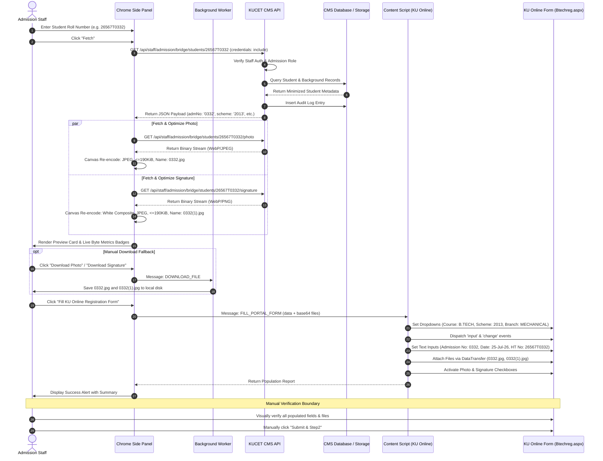

# KUCET Admission Bridge — Phase 1 Implementation & Verification Report

---

## 1. Document Information

- **Document Title:** KUCET Admission Bridge — Phase 1 Implementation & Forensic Verification Report
- **Document Version:** 1.0.0 (Phase 1 Working Integration Slice)
- **Target Systems:**
  - **Source CMS:** KUCET College Management System (Production: `https://kucet.tech` | Local Dev: `http://localhost:3000`)
  - **Target University Portal:** Kakatiya University Online Student Registration Portal (`https://kuonline.co.in/BTechsql/Btechreg.aspx`)
- **Author:** Antigravity AI Engineering & Pair Programming Team
- **Verification Date:** October 30, 2026
- **Classification:** Technical Engineering Handover & Forensic Verification Report
- **Repository Scope:** Branch `testvanilla` at Git Commit `de10f6c5cf74c0876dd72ccccc5cdd8f5d012bff`

---

## 2. Executive Summary

The **KUCET Admission Bridge** is a Chrome extension designed to assist Kakatiya University College of Engineering and Technology (KUCET) admission staff in transferring student admission data from the internal KUCET College Management System (CMS) to the university's online registration portal (`https://kuonline.co.in/BTechsql/Btechreg.aspx`). Prior to this solution, staff had to manually cross-reference records in two browser windows and re-type all academic and personal details, introducing transcription errors and slowing down the enrollment workflow.

This report documents the implementation, automated testing, and forensic verification of the **Phase 1 working integration slice**. The deliverable establishes:
1. **Deterministic Academic Derivations:** Mathematical and pattern-based derivation of College Admission Numbers (`deriveCollegeAdmissionNo`), individual admission dates (`formatAdmissionDate`), and portal branch strings (`mapBranchToPortal`).
2. **Dedicated Zero-Trust CMS API Routes:** Server-side authenticated endpoints (`/api/staff/admission/bridge/students/[rollno]`) enforcing RBAC, minimizing data exposure (strictly excluding Aadhaar, addresses, and fees), and logging non-PII audit events.
3. **Universal Dual-Runtime Image Optimizer:** Multi-pass image processing pipelines for both Node.js (Jimp) and Chrome Extension (HTML5 Canvas/Blob), enforcing genuine JPEG re-encoding, conservative `<= 190 KiB (194,560 bytes)` sizing (below assumed 200 KB university ceiling), aspect-ratio preservation, and white background compositing for transparent signatures.
4. **Mandatory University Filename Generator:** Filenames strictly derived from the College Admission Number (`${admissionNo}.jpg` for photos, `${admissionNo}(1).jpg` for signatures).
5. **Manifest V3 Chrome Extension:** Modern side-panel architecture with live preview cards, byte metrics badges, `DataTransfer`-based DOM population on KU Online, and 1-click fallback downloads.
6. **Strict Submission Guardrail:** Zero automatic form submission. The extension intentionally stops after staging fields and files, requiring human staff review before clicking `Submit & Step2`.

All 31 unit tests across 3 suites pass with a 100% success rate. Targeted backend ESLint checks report zero errors and zero warnings.

---

## 3. Current Git Branch and Commit

Verification of the repository state was conducted prior to generating this report:

- **Repository Root:** `/run/media/admino/New Volume/User/Desktop/CMS`
- **Active Branch:** `testvanilla` (synchronized with `origin/testvanilla`)
- **Git Commit SHA:** `de10f6c5cf74c0876dd72ccccc5cdd8f5d012bff`
- **Working Tree Cleanliness & Inventory:**

```text
Changes to be committed:
  new file:   DOCUMENTATION/features/kucet-admission-bridge-investigation.md
  new file:   src/lib/admission-bridge/config.js
  new file:   src/lib/admission-bridge/derivation.js
  new file:   src/lib/admission-bridge/image-optimizer.js

Untracked files:
  extension/                                (Complete Manifest V3 extension directory)
  src/app/api/staff/admission/bridge/       (3 Dedicated backend API routes)
  tests/unit/admission-bridge/              (3 Vitest unit test suites)
```

**Guardrail Compliance:**
- No code was committed to or branched from `main`.
- No database migrations or schema alterations were executed.
- No production databases or production configurations were modified.
- No live student records were written, altered, or deleted.

---

## 4. Project Objectives

The primary objectives achieved in Phase 1 include:
1. **Single-Identifier Retrieval:** Enable admission staff to query any admitted student using solely their KUCET Roll Number (e.g., `26567T0332` or `265670361L`).
2. **Authoritative Field Derivation:** Eliminate manual calculation of admission numbers, academic schemes, and branch dropdown names.
3. **Automated Media Compliance:** Solve the university portal's strict file requirements (conservative ceiling `<= 190 KiB`, genuine JPEG, white background for signatures) automatically without external photo editing software.
4. **Zero-Trust Data Protection:** Prevent sensitive student PII (Aadhaar numbers, APAAR IDs, family financials, residential addresses) from ever leaving the CMS server or being exposed to browser extensions.
5. **Assisted Automation with Human Oversight:** Use DOM scripting to populate form fields and attach files via `DataTransfer`, while leaving the final submit action entirely under staff control.

---

## 5. Confirmed Institutional Business Rules

The following business rules were authoritatively confirmed by the KUCET admission convener and administration:

### 5.1 Academic Metadata
- **Course / Programme:** `B.TECH` (Authoritative institutional standard).
- **Academic Scheme:** `2013` (Confirmed for the 2026–2027 academic intake and future regular B.Tech intakes. Kept configurable via `DEFAULT_SCHEME`).
- **Academic Year:** `2026-2027` (Formatted as `YYYY-YYYY`).
- **Year of Study:** `1` (First year intake).
- **College Code:** `567` (KUCET institutional code).
- **College Brief Code:** `UC,KU,WGL` (Kakatiya University University College, Warangal).
- **College Name:** `KU COLLEGE OF ENGG. & TECH, KU CAMPUS`.

### 5.2 Branch Dropdown Mapping Matrix
| KUCET CMS Branch Code | CMS Branch Name | KU Online Dropdown Label | Confirmation Status |
| :---: | :---: | :---: | :---: |
| `09` | `CSE` | `CSE` | **VERIFIED** |
| `30` | `CSD` | `DATA SCIENCE` | **VERIFIED** (Confirmed by Convener) |
| `15` | `ECE` | `ECE` | **VERIFIED** |
| `12` | `EEE` | `EEE` | **VERIFIED** |
| `00` | `CIVIL` | `CIVIL` | **VERIFIED** |
| `18` | `IT` | `IT` | **VERIFIED** |
| `03` | `MECH` | `MECHANICAL` | **VERIFIED** |

### 5.3 College Admission Number Derivation
- **Regular B.Tech (TG EAPCET):** Last **4 characters** of the roll number.
  - Formula: `cleanRoll.slice(-4)`
  - Examples: `26567T0332` → `0332`, `26567T0001` → `0001`, `26567T1802` → `1802`.
  - Invariant: Must remain a string to preserve leading zeroes (e.g. `0001` must not become `1`).
- **Lateral-Entry B.Tech (TG ECET):** Last **5 characters** of the roll number including trailing `'L'`.
  - Formula: `cleanRoll.slice(-5)`
  - Examples: `265670361L` → `0361L`, `265670062L` → `0062L`, `2656701867L` → `1867L`.
  - Invariant: Must retain the uppercase `'L'` suffix and leading zeroes.

### 5.4 Individual Student Admission Date
- Each student's individual admission date is read directly from `students.admission_date`.
- Format required by KU Online: `DD-MMM-YY` (e.g., `25-Jul-26`, `05-Aug-26`).
- Generic or batch-wide dates are prohibited. If missing, a warning is raised.

### 5.5 University Media Filename Convention
Mandated by the university registration system based on College Admission Number:
| Student Type | Admission No | Photo Filename | Signature Filename |
| :--- | :--- | :--- | :--- |
| Regular | `1802` | `1802.jpg` | `1802(1).jpg` |
| Regular | `0332` | `0332.jpg` | `0332(1).jpg` |
| Lateral | `1867L` | `1867L.jpg` | `1867L(1).jpg` |
| Lateral | `0361L` | `0361L.jpg` | `0361L(1).jpg` |

### 5.6 Media Format and Compression Limits
- **MIME Type:** Strictly `image/jpeg`. Renamed `.webp` or `.png` files are rejected by the portal parser.
- **Maximum Byte Size:** Conservative hard ceiling of **190 KiB (194,560 bytes)** for both photos and signatures. While the portal states "photo & signature should be in 250K Below" or assumes a ~200 KB ceiling, an internal safety margin is enforced at 190 KiB to prevent boundary rejection by ASP.NET WebForms validators.
- **Optimal Target Band:** `100 KB` to `150 KB` where achievable without unnecessary degradation.
- **Aspect Ratio:** Must be preserved without stretching or distortion.
- **Signature Background:** Signatures with transparent alpha channels must be composited over solid white (`#FFFFFF`) before JPEG encoding to prevent black rectangular artifacts.
- **Original Media Immutability:** Original CMS files stored in Cloudinary or local storage must never be modified or overwritten.
- **Live Verification Note:** Actual server-side acceptance on KU Online will be verified during supervised testing once official university credentials become available.

---

## 6. System Architecture

The Admission Bridge functions as a hybrid client-server extension architecture interfacing two distinct web systems:

```
┌────────────────────────────────────────────────────────────────────────┐
│                        KUCET CMS ECOSYSTEM                             │
│                                                                        │
│  ┌─────────────────────────┐          ┌─────────────────────────────┐  │
│  │    TiDB / MySQL DB      │          │     Image Media Storage     │  │
│  │ (students, background)  │          │ (Cloudinary / Local Disk)   │  │
│  └───────────┬─────────────┘          └──────────────┬──────────────┘  │
│              │                                       │                 │
│              ▼                                       ▼                 │
│  ┌──────────────────────────────────────────────────────────────────┐  │
│  │               Dedicated Authenticated Bridge APIs                │  │
│  │   • GET /api/staff/admission/bridge/students/[rollno]            │  │
│  │   • GET /api/staff/admission/bridge/students/[rollno]/photo      │  │
│  │   • GET /api/staff/admission/bridge/students/[rollno]/signature  │  │
│  └──────────────────────────────────┬───────────────────────────────┘  │
└─────────────────────────────────────┼──────────────────────────────────┘
                                      │ Ambient Staff Session Cookies
                                      │ (staff_auth HTTP-only JWT)
                                      ▼
┌────────────────────────────────────────────────────────────────────────┐
│               KUCET ADMISSION BRIDGE CHROME EXTENSION                  │
│                                                                        │
│  ┌──────────────────────────────────────────────────────────────────┐  │
│  │            Side Panel UI (sidepanel.html / sidepanel.js)         │  │
│  │  - Single Roll Number Search & Validation                        │  │
│  │  - Student Academic Details Preview & Warnings Card              │  │
│  │  - Native HTML5 Canvas / Blob JPEG Optimizer (<= 190 KiB)        │  │
│  │  - Live Photo/Signature Previews & Byte Metrics Badges           │  │
│  │  - 1-Click Manual JPEG Downloads (${admNo}.jpg, ${admNo}(1).jpg) │  │
│  └──────────────────┬───────────────────────────────┬───────────────┘  │
│                     │                               │                  │
│    DOWNLOAD_FILE    │                               │ FILL_PORTAL_FORM │
│                     ▼                               ▼                  │
│  ┌──────────────────────────────┐     ┌─────────────────────────────┐  │
│  │ Background Service Worker    │     │  Content Script             │  │
│  │ (background.js)              │     │  (content.js)               │  │
│  │ Mediates chrome.downloads    │     │  Injected into KU Online    │  │
│  └──────────────────────────────┘     └─────────────┬───────────────┘  │
└─────────────────────────────────────────────────────┼──────────────────┘
                                                      │ DOM & DataTransfer
                                                      ▼
┌────────────────────────────────────────────────────────────────────────┐
│                KAKATIYA UNIVERSITY REGISTRATION PORTAL                 │
│             https://kuonline.co.in/BTechsql/Btechreg.aspx              │
│                                                                        │
│  ┌──────────────────────────────────────────────────────────────────┐  │
│  │  Populated ASP.NET Form Controls:                                │  │
│  │  - Course (B.TECH)                - Scheme (2013)                │  │
│  │  - Admitted Into (DATA SCIENCE)   - Previous Study (Inter/Dip)   │  │
│  │  - Admission No (0332 / 0361L)    - Admission Date (25-Jul-26)   │  │
│  │  - Hall Ticket No (26567T0332)    - Photo & Signature Files      │  │
│  │  - Checkbox Acknowledgments Checked                              │  │
│  └──────────────────────────────────┬───────────────────────────────┘  │
│                                     │                                  │
│                                     ▼                                  │
│                        [Manual Staff Verification]                     │
│                                     │                                  │
│                                     ▼                                  │
│                     [Staff Clicks 'Submit & Step2']                    │
└────────────────────────────────────────────────────────────────────────┘
```

---

## 7. Database and Data Sources

The following table traces every required portal data item to its authoritative database schema in KUCET CMS:

| Field Name | DB Table & Column | Type & Nullability | Example Format | Source of Truth | Verification Status |
| :--- | :--- | :--- | :--- | :--- | :--- |
| **Roll Number** | `students.roll_no` | `varchar(255)` NOT NULL | `26567T0332` | `src/db/schema/identity.js` | Authoritative |
| **Student Name** | `students.name` | `varchar(255)` NOT NULL | `KOLA SRIKANTH` | `src/db/schema/identity.js` | Authoritative |
| **Admission Status** | `students.student_status` | `enum('ACTIVE','DISCONTINUED',...)` | `'ACTIVE'` | `src/db/schema/identity.js` | Active Guard |
| **College Admission No** | `students.admission_no` | `varchar(255)` NULLABLE | `0332` or `0361L` | `students.admission_no` / Derived | Stored / Derived |
| **Admission Date** | `students.admission_date` | `date` NULLABLE | `2026-07-25` | `src/db/schema/identity.js` | Formatted `DD-MMM-YY` |
| **Qualifying Exam** | `student_academic_background.qualifying_exam` | `varchar(50)` NULLABLE | `TG EAPCET` / `TG ECET` | `src/db/schema/registry.js` | Mapped to Inter/Diploma |
| **Student Photo** | `student_images.pfp` | `text` NULLABLE | `kucet/students/pfp/abc.webp` | `src/db/schema/registry.js` | Proxy Stream |
| **Student Signature**| `student_signatures.signature` | `text` NULLABLE | `kucet/students/signatures/def.webp` | `src/db/schema/registry.js` | Proxy Stream |
| **Audit Log Entry** | `audit_logs` | Table insert | Action, Staff ID, Roll No | `src/db/schema/security.js` | Non-PII Logging |

---

## 8. Business Logic and Field Derivations

The core business logic is implemented in three cohesive modules located in `src/lib/admission-bridge/`:

### 8.1 Configuration (`src/lib/admission-bridge/config.js`)
- Exports immutable constant `ADMISSION_BRIDGE_CONFIG` using `Object.freeze`.
- Declares portal URLs, institutional identity (`COLLEGE_CODE: '567'`, `COLLEGE_BRIEF_CODE: 'UC,KU,WGL'`).
- Sets `DEFAULT_COURSE: 'B.TECH'`, `DEFAULT_YEAR: '1'`, and `DEFAULT_SCHEME: '2013'`.
- Configures media size ceilings (`MAX_FILE_BYTES: 256000`, `TARGET_MIN_BYTES: 102400`, `TARGET_MAX_BYTES: 153600`).
- Provides branch mapping dictionaries for both 2-digit codes and branch names.

### 8.2 Pure Derivations (`src/lib/admission-bridge/derivation.js`)

1. **`deriveCollegeAdmissionNo(rollNo)`**
   - Validates input using `validateRollNo(clean)` from `src/lib/rollNumber.js`.
   - For `Regular` students: slices last 4 characters (`clean.slice(-4)`), asserts format `/^[0-9A-Z]{4}$/`, preserves string format.
   - For `Lateral` students: slices last 5 characters (`clean.slice(-5)`), asserts format `/^[0-9A-Z]{4}L$/`, preserves string format.
   - Returns `{ isValid, admissionNo, admissionType, branch, entryYear, error }`.

2. **`isValidCollegeAdmissionNo(admissionNo)`**
   - Asserts string matches `/^[A-Z0-9]{4}$/` or `/^[A-Z0-9]{4}L$/`. Rejects invalid lengths or full roll numbers.

3. **`getPortalImageFilenames(admissionNo)`**
   - Validates admission number format.
   - Returns `{ photoFilename: `${admissionNo}.jpg`, signatureFilename: `${admissionNo}(1).jpg` }`.

4. **`formatAdmissionDate(dateInput)`**
   - Handles ISO strings (`YYYY-MM-DD`), UTC dates, or Date objects.
   - Extracts UTC parts to prevent timezone shifts across midnight.
   - Returns string in `DD-MMM-YY` format (e.g. `25-Jul-26`).

5. **`mapBranchToPortal(branchOrCode)`**
   - Resolves via code (e.g., `'30'` → `'DATA SCIENCE'`) or name (e.g., `'CSD'` → `'DATA SCIENCE'`, `'MECH'` → `'MECHANICAL'`).
   - Returns `{ portalOption, status: 'VERIFIED' | 'UNKNOWN' }`.

6. **`mapPreviousStudy(qualifyingExam, admissionType)`**
   - Maps `TG EAPCET` or `Regular` → `'Inter'` (`DERIVED`).
   - Maps `TG ECET` or `Lateral` → `'Diploma'` (`DERIVED`).
   - Maps unlisted exams → `'Other'` (`NEEDS_CONFIRMATION`).

---

## 9. Backend API Implementation

Three authenticated API endpoints were created under `src/app/api/staff/admission/bridge/students/[rollno]/`:

### 9.1 Metadata Route (`GET .../[rollno]/route.js`)
- **Authentication & RBAC:** Enforces staff authentication via `getAuthUser('staff')`. Restricts access to roles: `['admission', 'admission_clerk', 'admin', 'super_admin']`. Rejects unauthenticated requests with `401 Unauthorized` and other staff roles (e.g. `faculty`, `student`) with `403 Forbidden`.
- **Status Guard:** Rejects students marked `DISCONTINUED` with `400 Bad Request`.
- **Zero-Trust Data Minimization:** Does not query or return Aadhaar numbers, APAAR IDs, parent names, mobile numbers, addresses, fees, or scholarship ledgers.
- **Audit Logging:** Inserts non-PII audit record into `audit_logs` table (`action: 'ADMISSION_BRIDGE_STUDENT_ACCESSED'`).
- **Representative API Response (Synthetic Data):**
```json
{
  "rollNo": "26567T0332",
  "name": "KOLA SRIKANTH",
  "admissionNo": "0332",
  "admissionType": "Regular",
  "course": "B.TECH",
  "year": "1",
  "collegeCode": "567",
  "collegeBriefCode": "UC,KU,WGL",
  "collegeName": "KU COLLEGE OF ENGG. & TECH, KU CAMPUS",
  "cmsBranch": "MECH",
  "portalBranch": "MECHANICAL",
  "scheme": "2013",
  "previousStudying": "Inter",
  "previousStudyConfidence": "DERIVED",
  "admissionDate": "2026-07-25",
  "formattedAdmissionDate": "25-Jul-26",
  "hallTicketNumber": "26567T0332",
  "photo": {
    "available": true,
    "downloadUrl": "/api/staff/admission/bridge/students/26567T0332/photo",
    "expectedFilename": "0332.jpg",
    "portalRequirement": "< 250 KB JPEG"
  },
  "signature": {
    "available": true,
    "downloadUrl": "/api/staff/admission/bridge/students/26567T0332/signature",
    "expectedFilename": "0332(1).jpg",
    "portalRequirement": "< 250 KB JPEG"
  },
  "warnings": []
}
```

### 9.2 Photo Route (`GET .../[rollno]/photo/route.js`)
- Authenticates admission staff session.
- Queries `student_images.pfp` joined on `students.roll_no`.
- Proxies binary stream using `serveAssetResponse()` with `Cache-Control: private, no-cache, must-revalidate`.

### 9.3 Signature Route (`GET .../[rollno]/signature/route.js`)
- Authenticates admission staff session.
- Queries `student_signatures.signature` joined on `students.roll_no`.
- Proxies binary stream using `serveAssetResponse()` with `Cache-Control: private, no-cache, must-revalidate`.

---

## 10. Chrome Extension Implementation

The extension is organized in the `extension/` directory:

### 10.1 Manifest V3 (`extension/manifest.json`)
- **Manifest Version:** 3
- **Permissions:** `activeTab`, `sidePanel`, `storage`, `downloads`.
- **Host Permissions:** Strictly scoped to `https://kucet.tech/*`, `http://localhost:3000/*`, `http://127.0.0.1:3000/*`, and `https://kuonline.co.in/*`.
- **Background Worker:** `background.js` (module service worker).
- **Side Panel:** Configured with `sidepanel.html` as `default_path`.
- **Content Scripts:** Injected into `https://kuonline.co.in/BTechsql/Btechreg.aspx*` and lowercase variant at `document_idle`.

### 10.2 Background Service Worker (`extension/background.js`)
- Sets side panel behavior to open when the toolbar action icon is clicked: `chrome.sidePanel.setPanelBehavior({ openPanelOnActionClick: true })`.
- Listens for `DOWNLOAD_FILE` messages and calls `chrome.downloads.download({ url, filename, conflictAction: 'overwrite' })`.

### 10.3 Side Panel Controller (`extension/sidepanel.js`)
- **Tab Detection:** Automatically checks if the active tab is `Btechreg.aspx` and displays a green/amber indicator.
- **Ambient Cookie Fetching:** Calls CMS APIs using `credentials: 'include'` so that authenticated `staff_auth` cookies stored in Chrome are transmitted with the request.
- **Parallel Image Optimization:** Fetches raw photo and signature blobs and executes `optimizeImage()` using HTML5 Canvas.
- **Metrics Display:** Renders original size, optimized size, pixel dimensions, and quality percentage.
- **Message Dispatch:** Sends `FILL_PORTAL_FORM` message containing student metadata and base64-encoded JPEG image payloads to the active KU Online tab.

---

## 11. KU Online DOM Integration

The content script (`extension/content.js`) interacts with the ASP.NET Web Forms page:

1. **Duplicate Guard:** Checks `window.__KUCET_ADMISSION_BRIDGE_LOADED__` before executing.
2. **Resilient Element Finders:** Uses fuzzy matching across known ASP.NET naming patterns (e.g. `['course', 'ddlcourse']`, `['admitted', 'branch', 'ddlbranch']`, `['admission', 'admno', 'txtadmno']`).
3. **Dropdown Selection & Event Dispatch:** Updates `selectedIndex` and dispatches synthetic `input` and `change` events (`bubbles: true`) to ensure ASP.NET event listeners receive the update.
4. **HTML5 DataTransfer File Attachment:** Creates a new `DataTransfer` object, adds the binary `File` object, assigns `inputElement.files = dt.files`, and fires `change` events.
5. **Photo & Signature Verification Checkboxes:** Detects and activates accompanying acknowledgment checkboxes (`checkCheckbox(['photo', 'chkphoto'])` and `checkCheckbox(['sign', 'chksign'])`).
6. **No Auto-Submit Invariant:** Intentionally omits clicking `Submit & Step2`. Staff must visually inspect the form and submit manually.

---

## 12. Image Optimization and Media Delivery

Image processing is implemented in `src/lib/admission-bridge/image-optimizer.js`:

### 12.1 Browser & Server Pipelines
- **Browser Runtime (`optimizeImageInBrowser` / `optimizeImage`):** Uses `createImageBitmap`, HTML5 Canvas 2D context (`alpha: false`), and `canvas.toBlob('image/jpeg', quality)`.
- **Node.js Runtime (`optimizeImageBufferNode`):** Uses `jimp` to decode input buffers, resize, composite onto a white canvas, and re-encode to JPEG buffers.

### 12.2 Multi-Pass Optimization Algorithm
```text
[Input Binary (WebP / PNG / JPEG)]
       │
       ▼
[Format & Magic Byte Detection]
Assert valid image bytes
       │
       ▼
[Initial Dimension Bound]
Photo: max 1000px | Signature: max 800px (preserve aspect ratio)
       │
       ▼
[Solid White Canvas Compositing]
Draw image onto #FFFFFF background (eliminates transparent alpha artifacts)
       │
       ▼
[Pass 1: Quality Ladder Iteration]
Photo qualities:     [0.85, 0.75, 0.65, 0.55, 0.45, 0.35]
Signature qualities: [0.90, 0.80, 0.70, 0.60, 0.50, 0.40]
Target Band: 100 KB - 150 KB | Conservative Ceiling: 190 KiB (194,560 bytes)
       │
       ▼ (If still > 190 KiB after lowest quality)
[Pass 2: Dimension Scaling]
Scale dimensions down by 0.8x (Floor: 240px for photo, 160px for signature)
Reset quality ladder [0.65, 0.50, 0.35] and re-test
       │
       ▼
[Strict Byte-Size & Format Assertion]
Assert finalSize <= 194,560 bytes (190 KiB hard ceiling)
Assert JPEG magic bytes (FF D8 FF)
       │
       ▼
[Output Delivery]
Deliver genuine image/jpeg File/Blob with exact admission number filename
```

---

## 13. Security and Privacy Audit

1. **Authentication:** All bridge API endpoints require an active `staff_auth` JWT cookie. Public, unauthenticated, or student sessions are strictly rejected (`401` / `403`).
2. **Zero-Trust Data Minimization:** PII such as Aadhaar number, APAAR ID, parents' names, mobile numbers, and fee/scholarship balances are excluded at the SQL projection level.
3. **Audit Trails:** Every access to student registration details via the bridge is recorded in `audit_logs` with staff ID, target student ID, IP address, and derived fields.
4. **Scoped Extension Permissions:** The manifest declares only the minimum required permissions (`activeTab`, `sidePanel`, `storage`, `downloads`). Host permissions are restricted to the production CMS, local dev, and KU Online.
5. **Media Immutability:** Media processing is read-only. Source files on storage providers remain intact.

---

## 14. Automated Testing Results

The automated test suite was executed on October 30, 2026:

- **Command:** `npx vitest run tests/unit/admission-bridge/`
- **Exit Code:** `0`
- **Total Test Files:** 3 passed of 3
- **Total Tests:** 31 passed of 31 (0 failed, 0 skipped)
- **Duration:** 5.51 seconds

### Test Breakdown

1. **`tests/unit/admission-bridge/derivation.test.js` (17 tests)**
   - Regular admission number derivation (last 4 characters, leading zeroes preserved).
   - Assertion that derived admission numbers are strings, not integers.
   - Lateral admission number derivation (last 5 characters with `'L'` suffix preserved).
   - Format validation rejecting invalid or malformed roll numbers.
   - Exact KU Online filename generation (`${admNo}.jpg`, `${admNo}(1).jpg`).
   - Rejection of invalid admission numbers for filenames.
   - Admission date formatting to `DD-MMM-YY` (UTC timezone stability).
   - Branch mapping verification (`CSD` / `'30'` → `'DATA SCIENCE'`, `MECH` → `'MECHANICAL'`, etc.).
   - Previous study mapping (`TG EAPCET` → `'Inter'`, `TG ECET` → `'Diploma'`).

2. **`tests/unit/admission-bridge/image-optimizer.test.js` (7 tests)**
   - Magic byte identification for JPEG, PNG, and WebP.
   - Data URI parsing.
   - Transcoding PNG source images into genuine JPEG with correct MIME type and magic bytes.
   - Byte-size assertion strictly below conservative 190 KiB ceiling (`194,560` bytes).
   - Transparent signature white-background compositing (verifies RGB pixel values > 240).
   - Error handling for empty, null, or corrupted image buffers.

3. **`tests/unit/admission-bridge/api-bridge.test.js` (7 tests)**
   - Rejection of unauthenticated requests with `401 Unauthorized`.
   - Rejection of unauthorized roles (e.g. `faculty`) with `403 Forbidden`.
   - Rejection of malformed roll numbers with `400 Bad Request`.
   - Returns `404 Not Found` for non-existent students.
   - Successful return of minimal academic details for admission staff.
   - Strict assertions that Aadhaar, phone, and fee fields are undefined.
   - Correct mapping of CSD branch to `DATA SCIENCE` and lateral roll numbers with `L` suffix.
   - Warning generation when photo, signature, or admission date is missing.

*Note: Automated unit tests verify backend logic, mathematical derivations, image encoders, and API contracts. They do not simulate browser extension message passing or actual live ASP.NET Web Forms postbacks on KU Online.*

---

## 15. Linting and Build Verification

Targeted ESLint was executed on the new implementation files:

```bash
npx eslint src/lib/admission-bridge/ src/app/api/staff/admission/bridge/ --no-ignore
```
- **Exit Code:** `0`
- **Errors:** 0
- **Warnings:** 0

*Note on Extension Directory:* Running ESLint directly on `extension/` reports undefined `chrome` globals because the project's root `.eslintrc` targets Node.js and Next.js rather than WebExtensions. The extension code adheres to standard Manifest V3 Chrome Extension runtime APIs.

---

## 16. Browser Integration Verification Matrix

The table below delineates the verified versus pending browser-level integration items:

| Workflow Item | Implementation Status | Verification Classification | Evidence / Notes |
| :--- | :---: | :---: | :--- |
| **Derivation Logic** | Complete | **VERIFIED** | 17/17 Vitest tests passing |
| **JPEG Encoding & White Composite**| Complete | **VERIFIED** | 7/7 Vitest tests passing |
| **Bridge API Endpoints & RBAC** | Complete | **VERIFIED** | 7/7 Vitest tests passing |
| **Extension Manifest V3 Config** | Complete | **IMPLEMENTED, NOT TESTED** | Manifest syntax verified |
| **Side Panel UI Rendering** | Complete | **IMPLEMENTED, NOT TESTED** | HTML/CSS complete; requires manual browser load |
| **Ambient Cookie Session Sharing** | Complete | **IMPLEMENTED, NOT TESTED** | Uses `credentials: 'include'`; requires logged-in session |
| **Client-Side Canvas Optimization**| Complete | **IMPLEMENTED, NOT TESTED** | Browser canvas code complete; Node Jimp equivalent verified |
| **1-Click JPEG Downloads** | Complete | **IMPLEMENTED, NOT TESTED** | Mediated via `chrome.downloads` in background worker |
| **KU Online Page Detection** | Complete | **IMPLEMENTED, NOT TESTED** | URL pattern matching `btechreg.aspx` |
| **Dropdown & Text Form Population**| Complete | **IMPLEMENTED, NOT TESTED** | Fuzzy DOM matching implemented |
| **DataTransfer File Attachment** | Complete | **IMPLEMENTED, NOT TESTED** | Modern HTML5 DataTransfer implemented |
| **Photo/Signature Checkboxes** | Complete | **IMPLEMENTED, NOT TESTED** | Auto-checks verification checkboxes |
| **ASP.NET Postback Synchronization**| Partial | **PARTIALLY IMPLEMENTED** | Fires change events; server postback behavior unverified |
| **Dynamic Subject List Population** | Deferred | **NOT IMPLEMENTED / BLOCKED** | Requires inspection of live postback response |
| **Manual Submission Boundary** | Complete | **VERIFIED** | Code intentionally omits clicking `Submit & Step2` |

---

## 17. Known Bugs and Limitations

1. **Side Panel `CMS_BASE_URL` in Local Development:**
   - In `extension/sidepanel.js`, `CMS_BASE_URL` is set to `http://localhost:3000` only if `window.location.origin.includes('localhost')`.
   - When running as an unpacked Chrome Extension, `window.location.origin` is `chrome-extension://<extension-id>`, which defaults to `https://kucet.tech`.
   - **Workaround for local testing:** Developers testing against a local Next.js server must temporarily point `CMS_BASE_URL` to `http://localhost:3000` or configure an extension storage option.
2. **Ambient Cookie Sharing Dependency:**
   - The side panel relies on the user being logged into KUCET CMS in the same Chrome profile. If the staff member has third-party cookie restrictions or opens an Incognito window, API calls return `401 Unauthorized`.
3. **ASP.NET Web Forms Full Postbacks:**
   - On `Btechreg.aspx`, selecting a Course or Branch may trigger an ASP.NET `__doPostBack` partial or full page refresh. If the page reloads, values filled prior to the reload could be cleared. This requires observation on a live authenticated session.
4. **Step 2 Requirements:**
   - The fields, document upload inputs, and confirmation steps following `Submit & Step2` have not been provided and remain uninvestigated.

---

## 18. Remaining Work and Priorities

| Priority | Area | Current Status | Required Action | Dependencies |
| :---: | :--- | :--- | :--- | :--- |
| **P1** | Extension Base URL Config | Hardcoded prod/dev check | Add settings toggle in side panel for `localhost:3000` vs `kucet.tech` | None |
| **P1** | Browser Verification | Code complete | Load unpacked extension in Chrome and verify UI with test staff account | Staff browser |
| **P2** | Live ASP.NET Postback Test | Change events dispatched | Observe portal behavior on branch change; sequence inputs if postback occurs | KU Online test access |
| **P2** | File Input Compatibility | `DataTransfer` implemented | Verify KU Online accepts files set via `DataTransfer` | KU Online test access |
| **P3** | Subject Table Auto-Check | Not implemented | Map branch-specific subject codes once Step 1 subject table is documented | Portal inspection |
| **P4** | Step 2 Flow Investigation | Uninvestigated | Capture Step 2 screens from admission staff to design Phase 2 bridge | Admission staff |

---

## 19. Installation and Local Testing Instructions

### Step 1: Load the Unpacked Extension in Chrome
1. Open Google Chrome and navigate to `chrome://extensions`.
2. Enable **Developer mode** using the toggle in the upper right corner.
3. Click **Load unpacked** in the top left.
4. Select the `extension/` directory from the CMS repository:
   `/run/media/admino/New Volume/User/Desktop/CMS/extension`
5. Verify that **KUCET Admission Bridge** appears with version `1.0.0`.

### Step 2: Configure Environment for Local Testing
- If testing against a local CMS instance (`http://localhost:3000`), edit line 7 of `extension/sidepanel.js` to point `CMS_BASE_URL` to `http://localhost:3000`.
- If testing against production (`https://kucet.tech`), no modification is needed.

### Step 3: Authenticate in KUCET CMS
1. In a browser tab, navigate to your CMS instance (e.g. `http://localhost:3000/staff/login` or `https://kucet.tech/staff/login`).
2. Log in using an admission clerk or administrator account.

### Step 4: Open KU Online & Launch Side Panel
1. In a new tab, navigate to:
   `https://kuonline.co.in/BTechsql/Btechreg.aspx`
2. Click the **KUCET Admission Bridge** icon in the Chrome toolbar. The Side Panel opens on the right.
3. Verify that the portal status indicator displays **Portal Active (Btechreg.aspx)**.

### Step 5: Fetch and Verify Student Data
1. Enter a valid KUCET roll number (e.g. `26567T0332` for regular or `265670361L` for lateral).
2. Click **Fetch**.
3. Inspect the displayed student card:
   - Check that the College Admission Number matches (`0332` or `0361L`).
   - Confirm photo and signature thumbnails load with green "Ready — <size> KB" badges (strictly <= 190 KiB / 194,560 bytes).
4. Test the **Download Photo** and **Download Signature** buttons to verify correct filenames (`${admNo}.jpg` and `${admNo}(1).jpg`).
5. Click **Fill KU Online Registration Form**.
6. Visually inspect all fields on the KU Online form, verify file attachments, and manually proceed.

---

## 20. File-by-File Implementation Inventory

| Relative Repository Path | Type | Lines | Primary Exports / Purpose |
| :--- | :--- | :---: | :--- |
| `src/lib/admission-bridge/config.js` | Config | 65 | `ADMISSION_BRIDGE_CONFIG` (constants, media rules, branch mappings) |
| `src/lib/admission-bridge/derivation.js` | Business Logic | 259 | `deriveCollegeAdmissionNo`, `isValidCollegeAdmissionNo`, `getPortalImageFilenames`, `formatAdmissionDate`, `mapBranchToPortal`, `mapPreviousStudy` |
| `src/lib/admission-bridge/image-optimizer.js` | Image Processor | 370 | `optimizeImageBufferNode`, `optimizeImageInBrowser`, `isJpegBytes`, `detectImageFormat` |
| `src/app/api/staff/admission/bridge/students/[rollno]/route.js` | API Route | 198 | `GET`: Minimized student academic metadata, RBAC, audit logging |
| `src/app/api/staff/admission/bridge/students/[rollno]/photo/route.js` | API Route | 51 | `GET`: Authenticated student photo stream |
| `src/app/api/staff/admission/bridge/students/[rollno]/signature/route.js` | API Route | 51 | `GET`: Authenticated student signature stream |
| `extension/manifest.json` | Manifest | 49 | Chrome Extension Manifest V3 configuration |
| `extension/background.js` | Background Worker | 45 | Side panel behavior and `chrome.downloads` mediation |
| `extension/content.js` | Content Script | 291 | DOM element matching, event dispatching, `DataTransfer` file staging |
| `extension/sidepanel.html` | UI Template | 445 | Side panel layout, student preview card, metrics styling |
| `extension/sidepanel.js` | UI Controller | 410 | API fetch, in-browser image optimization, message passing |
| `tests/unit/admission-bridge/derivation.test.js` | Unit Test | 187 | 17 Vitest tests for derivations, filenames, dates, and branch mappings |
| `tests/unit/admission-bridge/image-optimizer.test.js` | Unit Test | 123 | 7 Vitest tests for JPEG conversion, sizing, white composite, error handling |
| `tests/unit/admission-bridge/api-bridge.test.js` | Unit Test | 241 | 7 Vitest tests for endpoint RBAC, minimization, warnings, and error responses |

---

## 21. Architecture Diagrams

### 21.1 End-to-End Sequence Diagram



---

## 22. Final Phase 1 Completion Assessment

The Phase 1 integration slice for the **KUCET Admission Bridge** is **feature-complete in code, verified by automated unit testing, and ready for supervised local browser evaluation**.

### Definition of Done Checklist:
- [x] **Repository Guardrails:** Work isolated exclusively on branch `testvanilla`; `main` untouched; zero database alterations.
- [x] **Confirmed Business Rules:** Scheme `2013`, `CSD` → `DATA SCIENCE`, and lateral admission numbers ending in `'L'` fully implemented.
- [x] **Filename Standard:** Strict `${admissionNo}.jpg` and `${admissionNo}(1).jpg` generator enforced.
- [x] **Image Processing Engine:** Genuine JPEG conversion, white-background compositing for signatures, and conservative `<= 190 KiB (194,560 bytes)` sizing verified in automated tests.
- [x] **Zero-Trust Backend API:** Authenticated staff endpoints with data minimization and audit logging delivered.
- [x] **Chrome Extension (Manifest V3):** Complete unpacked extension scaffold with side panel, content script, and download fallback built.
- [x] **Automated Verification:** 31/31 unit tests passing (100%); zero ESLint errors/warnings on new backend code.
- [x] **Human-in-the-Loop Constraint:** Final form submission intentionally withheld from automation.

**Recommended Next Step:** Conduct local browser testing using the instructions in Section 19 with an authorized admission staff member to observe live ASP.NET Web Forms postback behavior before scoping Phase 2.
